# Integração Serverless de Pedidos: Eventos, Regras e Destinos no EventBridge

**Documento:** Arquitetura

> Roteiro de testes feito pelo dashboard: [TESTE.md](TESTE.md).

> Situação (07/11/2026): recursos criados no Console (configuração a conferir), código revisado, nada validado. Ver `tasks.md`.

## 1. Visão geral
Um **custom event bus** é o ponto único de recebimento. A Lambda publicadora emite eventos via `PutEvents`; quatro **rules** avaliam cada evento e encaminham os correspondentes a destinos distintos. O dashboard (login Cognito) mostra o resultado **observado**, distinguindo aceite no bus de processamento efetivo.

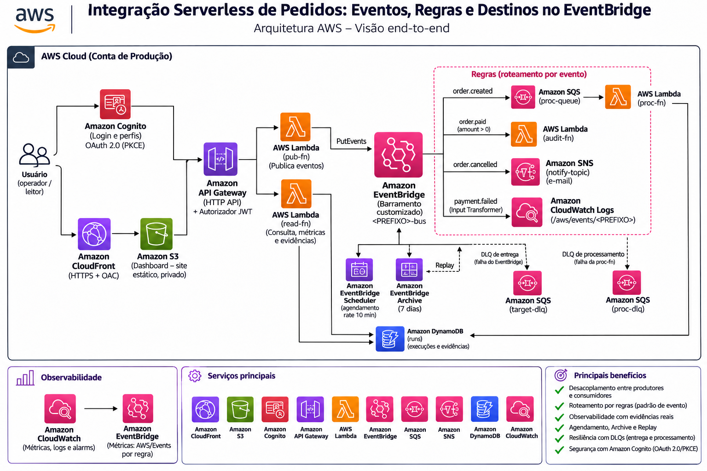

*Figura 1 — Arquitetura da solução, de ponta a ponta.*

O mesmo fluxo, em formato de diagrama de texto:

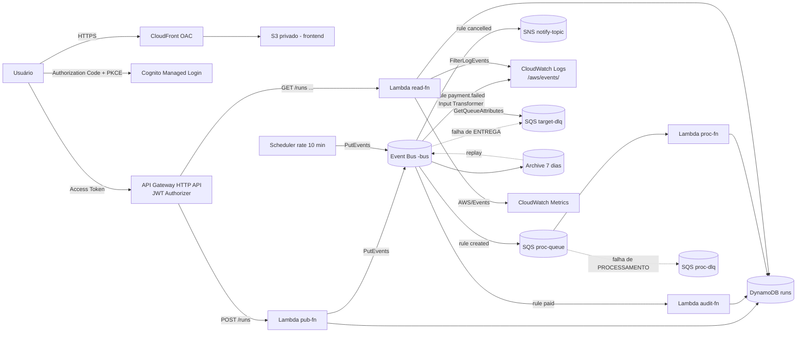

**Evidências visuais**

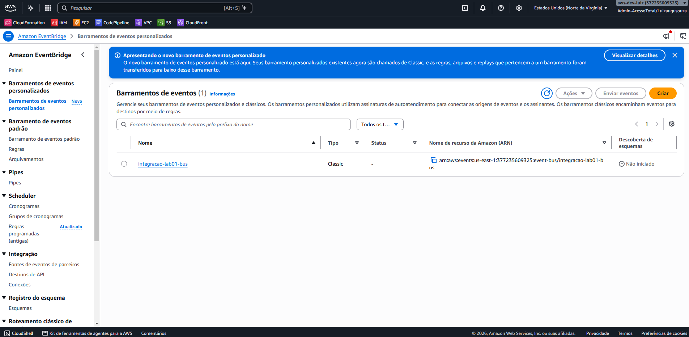

*Figura 2 — Barramento de eventos personalizado.*

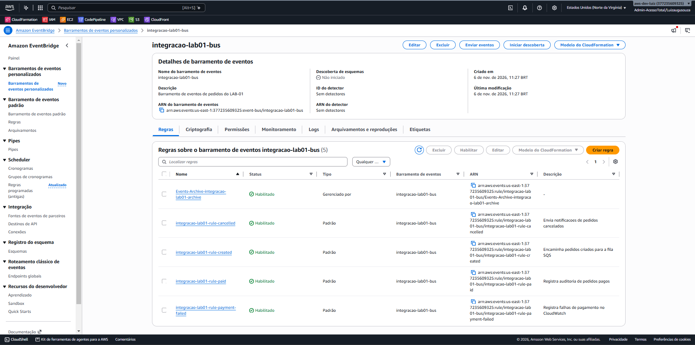

*Figura 3 — Regras do barramento, incluindo a regra gerenciada pelo Archive.*

## 2. Autenticação e autorização

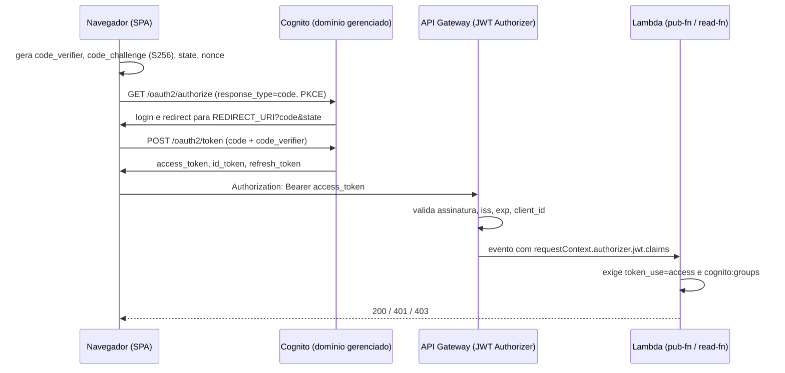

| Camada | Decide | Resultado |
|---|---|---|
| API Gateway (JWT Authorizer) | Token válido (assinatura, `iss`, `exp`, `client_id` = Audience) | **401** se inválido/ausente |
| `pub-fn` | `token_use=access` e grupo `operador` | **403** para `leitor` |
| `read-fn` | `token_use=access` e grupo `operador` ou `leitor` | **403** para usuário sem grupo |
| Navegador | Apenas exibição (perfil, botão desabilitado) | Não é barreira de segurança |

**Evidências visuais**

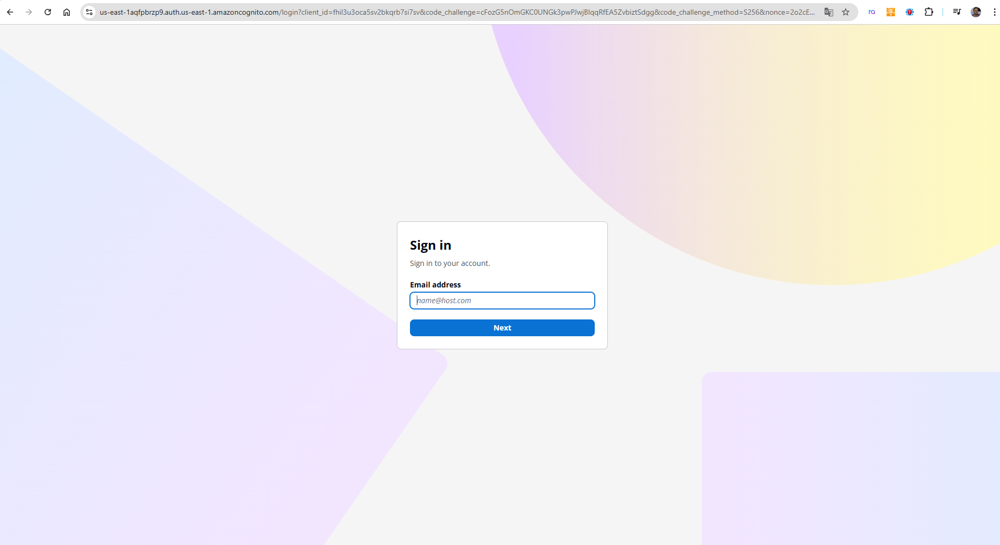

*Figura 4 — Login gerenciado do Cognito: etapa do e-mail.*

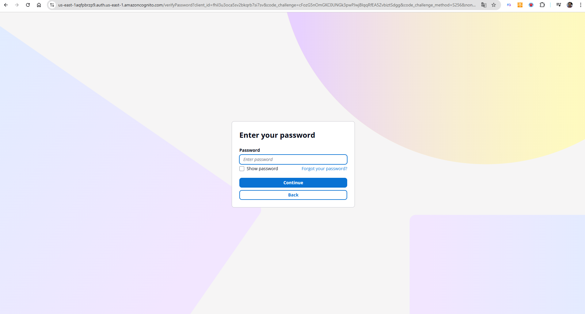

*Figura 5 — Login gerenciado do Cognito: etapa da senha.*

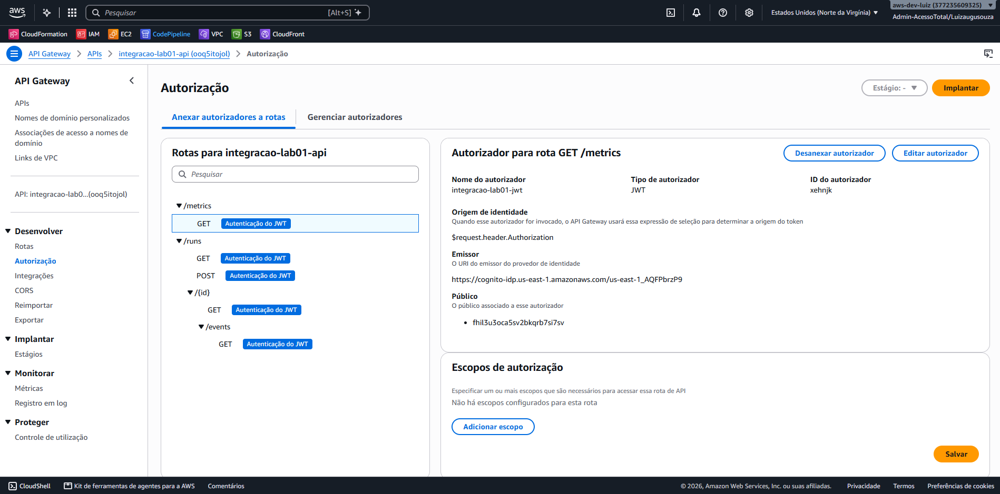

*Figura 6 — Autorizador JWT anexado às rotas da API, sem escopos configurados.*

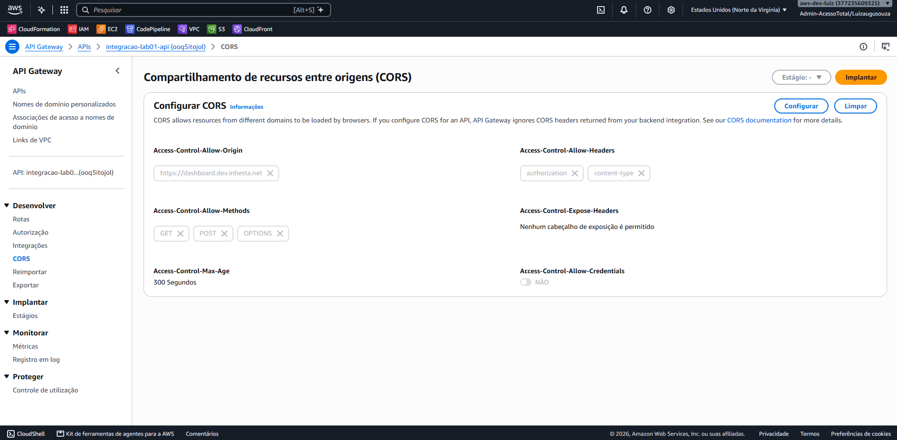

*Figura 7 — Configuração de CORS restrita ao endereço do dashboard.*

## 3. Componentes e justificativas
| Componente | Nome | Função | Por quê |
|---|---|---|---|
| Custom Event Bus | `<PREFIXO>-bus` | Recebe `PutEvents` | Isola eventos do lab do bus `default`. |
| Rule created | `<PREFIXO>-rule-created` | → SQS | Target de fila. |
| Rule paid | `<PREFIXO>-rule-paid` | → Lambda auditoria | Filtra também `detail.data.amount > 0`. |
| Rule cancelled | `<PREFIXO>-rule-cancelled` | → SNS | Notificação (sem evidência automática). |
| Rule payment.failed | `<PREFIXO>-rule-payment-failed` | → CloudWatch Logs | Input Transformer; evidência por log. |
| SQS proc-queue | `<PREFIXO>-proc-queue` | Fila de processamento | Desacopla o consumo; visibilidade 180 s; redrive 3. |
| SQS target-dlq | `<PREFIXO>-target-dlq` | DLQ de **entrega** | Falha do EventBridge ao entregar. |
| SQS proc-dlq | `<PREFIXO>-proc-dlq` | DLQ de **processamento** | Falha da `proc-fn` após 3 recebimentos. |
| Lambda proc / audit | `<PREFIXO>-proc-fn` / `-audit-fn` | Consumidores | Gravam evidência idempotente. |
| Lambda pub / read | `<PREFIXO>-pub-fn` / `-read-fn` | API | Autorização, publicação, leitura, métricas. |
| SNS | `<PREFIXO>-notify-topic` | Notificação | Target SNS. |
| Scheduler | `<PREFIXO>-schedule` | Agenda | Agenda x regra. |
| Archive | `<PREFIXO>-archive` | Arquivo | Replay controlado (7 dias). |
| DynamoDB | `<PREFIXO>-runs` | Log de processo | Fonte de `RUN` e evidências. |
| API Gateway | `<PREFIXO>-api` + `<PREFIXO>-jwt` | HTTP API | 5 rotas, CORS e throttling. |
| Cognito | `<PREFIXO>-pool` | Identidade | Grupos `operador` e `leitor`. |
| S3 + CloudFront + ACM + Route 53 | `<BUCKET>`, `<DISTRIBUTION_ID>` | Hospedagem | Privado com OAC e domínio próprio. |

**Evidências visuais**

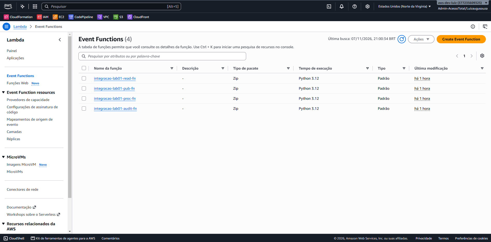

*Figura 8 — As quatro funções Lambda com runtime Python 3.12.*

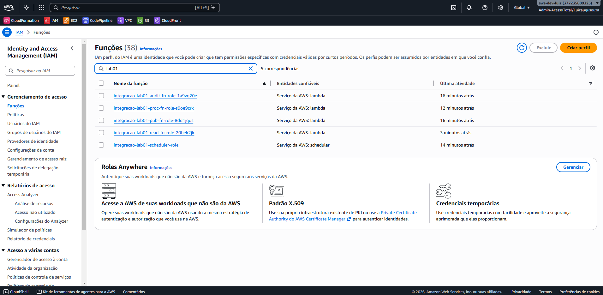

*Figura 9 — Perfis do IAM das funções Lambda e do Scheduler.*

## 4. Fluxo de dados
1. O usuário entra pelo Cognito (PKCE) e o dashboard guarda os tokens em `sessionStorage`.
2. `POST /runs` → `pub-fn` valida o perfil, grava `RUN` (`CREATED`), publica no bus e atualiza o resultado (`ACCEPTED`/`PARTIAL`/`FAILED`) com o resultado por entrada.
3. As rules avaliam cada evento; o `order.unknown` não casa com nenhuma e é descartado.
4. Consumidores gravam evidência no DynamoDB (`PROCESS#`, `AUDIT#`); a rule `payment.failed` grava a linha transformada no CloudWatch Logs; o SNS envia e-mail.
5. O Scheduler publica periodicamente `order.created` (`correlationId` único por disparo).
6. O Archive guarda eventos; um Replay reemite a janela escolhida. A idempotência é provada comparando DynamoDB e logs, **não** pelo status do Replay.
7. Falha de entrega → retry (2 tentativas, 1 h) → `target-dlq`. Falha de processamento → 3 recebimentos → `proc-dlq`.
8. `GET /runs` e `/metrics` consolidam DynamoDB + CloudWatch Logs + CloudWatch Metrics + profundidade da `target-dlq`.

**Evidências visuais**

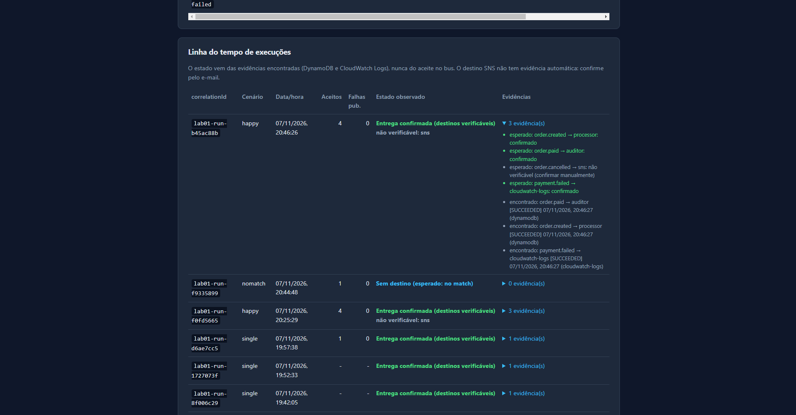

*Figura 10 — Linha do tempo com uma execução happy e as evidências expandidas.*

## 5. Modelo de estados (fidelidade)
**Publicação** (`state`): `CREATED` → `ACCEPTED` | `PARTIAL` | `FAILED`. É o resultado do `PutEvents`, **não** entrega.

**Observado** (`observedState`, por evidências):

| Estado | Condição |
|---|---|
| `AGUARDANDO` | Nenhuma evidência esperada e dentro da janela de 120 s |
| `PARCIAL` | Parte das evidências esperadas, dentro da janela |
| `CONFIRMADO` | Todas as evidências **verificáveis** esperadas presentes |
| `INCOMPLETO` | Janela expirada, faltam evidências |
| `SEM_EVIDENCIA` | Janela expirada, nenhuma evidência |
| `FALHA` | Falha de publicação ou evidência `FAILED` |
| `SEM_DESTINO` | Cenário `nomatch` sem evidência (esperado) |
| `INESPERADO` | Evidência onde não se esperava |
| `NAO_VERIFICAVEL` | Todos os destinos esperados sem evidência automática |

Destinos por tipo: `order.created`→processor (DynamoDB); `order.paid`→auditor (DynamoDB); `order.cancelled`→SNS (**sem evidência automática**); `payment.failed`→CloudWatch Logs.

## 6. Contrato de evento
```json
{"schemaVersion":"1.0","correlationId":"lab01-run-0001","eventType":"payment.failed","occurredAt":"2026-11-07T12:00:00+00:00","data":{"orderId":"order-0001-04","amount":203.6,"reason":"card_declined"}}
```

## 7. Observabilidade
- Logs estruturados com `correlationId`; tokens nunca são registrados.
- Métricas `AWS/Events` por rule (`MatchedEvents`, `TriggeredRules`, `Invocations`, `FailedInvocations`, `InvocationsSentToDlq`, `InvocationsFailedToBeSentToDlq`, `RetryInvocationAttempts`, `ThrottledRules`, `DeadLetterInvocations`); sem dado = "—".
- O dashboard é projeção do histórico observado, não fonte primária de verdade.

**Evidências visuais**

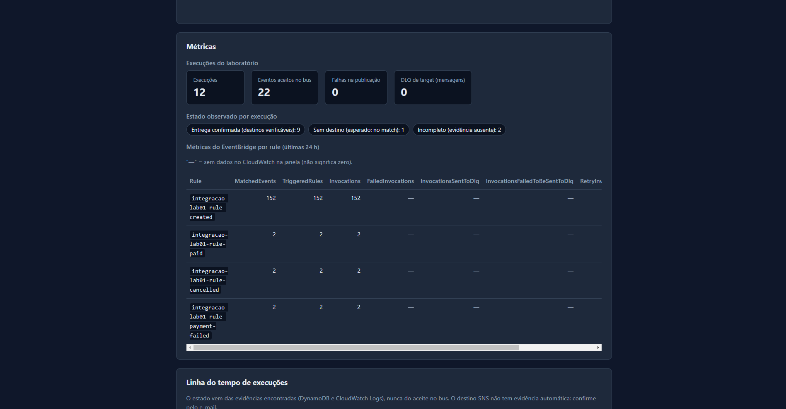

*Figura 11 — Métricas do projeto e do EventBridge por regra.*

## 8. Segurança
- S3 privado, acesso só por CloudFront OAC; bucket policy condicionada ao ARN da distribuição; HTTPS obrigatório.
- API: JWT Authorizer + autorização por grupo no backend; CORS exclusivo do dashboard; throttling.
- Frontend: CSP restritiva (`script-src 'self'`, `connect-src` limitado à API e ao Cognito), DOM sem `innerHTML`, sem tokens em arquivos ou logs.
- IAM de menor privilégio (`iam/policy-*.json`); resource policies por target (`iam/resource-policy-*.json`); SSE-SQS; SNS sem criptografia `aws/sns`.
- Dados sintéticos, sem PII.

**Evidências visuais**

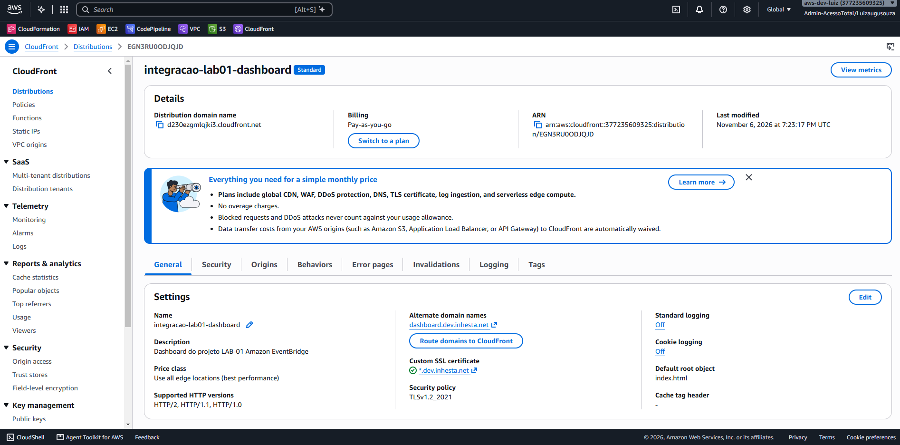

*Figura 12 — Distribuição do CloudFront com domínio alternativo, certificado personalizado e objeto raiz index.html.*

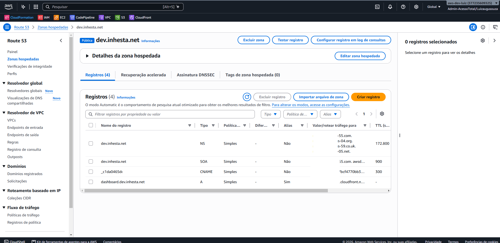

*Figura 13 — Zona hospedada no Route 53 com o registro Alias que aponta para o CloudFront.*

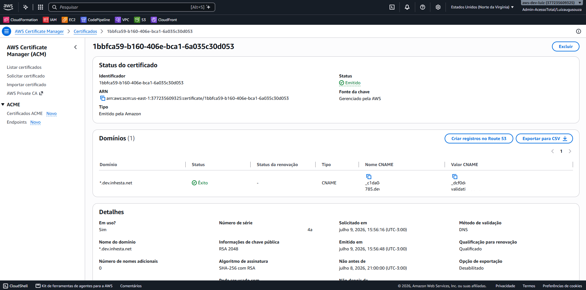

*Figura 14 — Detalhe do certificado do ACM, validado por DNS.*

## 9. Decisões de arquitetura
- **Quatro tipos de target** (fila, função, notificação, logs).
- **SQS + Lambda** (em vez de Lambda direta) para separar DLQ de entrega e DLQ de processamento.
- **Input Transformer só no target de logs**, mantendo `correlationId=` porque o dashboard o usa como evidência.
- **Scheduler separado das rules** para evidenciar agenda x evento; `correlationId` único por disparo.
- **Idempotência** com `ConditionExpression` no DynamoDB, essencial para Replay.
- **Authorization Code + PKCE** com App Client público; **Access Token** na API; perfil decidido no backend.
- **Evidência por origem**: DynamoDB para Lambdas, CloudWatch Logs para o target de logs, e SNS declarado "não verificável".

## 10. Limitações conhecidas
- SNS depende de confirmação manual por e-mail.
- `Scan` na listagem: adequado ao volume do projeto.
- Leitura de logs limitada a 5 páginas de 10 mil eventos e janela de 24 h.
- Tokens em `sessionStorage` ficam expostos a XSS; mitigado por CSP e DOM seguro, mas não eliminado.
- Retry exato de target só é observável com falhas retentáveis.
