# Integração Serverless de Pedidos: Eventos, Regras e Destinos no EventBridge

**Documento:** Guia de implantação pelo Console AWS (pt-BR)

> Roteiro de testes feito pelo dashboard: [TESTE.md](TESTE.md).

> Guia **operacional** para implantar e concluir o projeto manualmente pelo Console AWS.
> Este documento cobre **somente a implantação** (criar e configurar recursos, publicar o dashboard e integrar o login).
> Os **testes** ficam concentrados na **Parte B — Validação final**, que só deve ser iniciada depois que toda a Parte A estiver concluída.
>
> Nenhuma etapa deste guia é executada automaticamente. Nada aqui foi executado na sua conta AWS: o conteúdo foi escrito a partir do código do repositório e da documentação oficial da AWS. Os nomes de menus do Console mudam com frequência; sempre que possível indico o termo em português e o equivalente em inglês (entre parênteses).

## Como ler este guia

Cada etapa segue sempre a mesma estrutura:

1. **Objetivo** e explicação do serviço.
2. **Dependências** (o que precisa existir antes).
3. **Caminho de navegação** no Console.
4. **Tabelas de campos** com o valor exato; campos não listados ficam no padrão.
5. **O que acontece ao salvar**.
6. **Resultado esperado** (verificação visual, sem teste funcional).
7. **Erros comuns** e correção.

## Variáveis usadas neste guia

Nenhum valor real do seu ambiente aparece nos arquivos do repositório. Onde houver um destes marcadores, substitua pelo valor da **sua** conta antes de colar o texto no Console.

| Variável | O que representa | Exemplo de formato |
|---|---|---|
| `<ACCOUNT_ID>` | ID da conta AWS (12 dígitos) | `123456789012` |
| `<REGIAO>` | Região principal dos recursos | `us-east-1` |
| `<PREFIXO>` | Prefixo de todos os nomes de recursos | `meu-projeto` |
| `<BUCKET>` | Nome do bucket S3 do dashboard | `<PREFIXO>-dashboard-<ACCOUNT_ID>` |
| `<API_ID>` | ID da HTTP API | `abc123defg` |
| `<API_URL>` | URL base da API (sem barra final) | `https://<API_ID>.execute-api.<REGIAO>.amazonaws.com` |
| `<USER_POOL_ID>` | ID do grupo de usuários do Cognito | `<REGIAO>_AbCdEfGhI` |
| `<CLIENT_ID>` | ID do cliente de aplicação (público, sem segredo) | 26 caracteres alfanuméricos |
| `<COGNITO_DOMAIN>` | Endereço do login gerenciado do Cognito | `https://<prefixo-do-dominio>.auth.<REGIAO>.amazoncognito.com` |
| `<DISTRIBUTION_ID>` | ID da distribuição CloudFront | `E1ABCDEFGHIJKL` |
| `<URL_DASHBOARD>` | Endereço público do dashboard | `https://dashboard.exemplo.com` |
| `<DOMINIO_DASHBOARD>` | Mesmo endereço, sem `https://` | `dashboard.exemplo.com` |
| `<DOMINIO_RAIZ>` | Zona hospedada no Route 53 | `exemplo.com` |

> Fora das variáveis, alguns textos fazem parte do **contrato do código** e não mudam: o `source` dos eventos (`integracao.lab01.pedidos`), os prefixos de `correlationId` (`lab01-run-`, `lab01-sched-`) e a chave `lab01.session` do navegador. Se alterá-los, altere também as regras, o Scheduler e os handlers.

## Recursos do projeto

| Recurso | Nome | Etapa |
|---|---|---|
| DynamoDB | `<PREFIXO>-runs` | 1 |
| Cognito | `<PREFIXO>-pool`, grupos `operador` e `leitor` | 2 |
| SQS | `<PREFIXO>-proc-queue`, `<PREFIXO>-proc-dlq`, `<PREFIXO>-target-dlq` | 3 |
| SNS | `<PREFIXO>-notify-topic` | 4 |
| Lambda | `<PREFIXO>-pub-fn`, `-proc-fn`, `-audit-fn`, `-read-fn` | 5 |
| EventBridge | `<PREFIXO>-bus` e 4 regras | 6 |
| Scheduler | `<PREFIXO>-schedule` | 7 |
| Archive | `<PREFIXO>-archive` | 8 |
| API Gateway | `<PREFIXO>-api`, autorizador `<PREFIXO>-jwt` | 9 |
| S3, CloudFront, ACM, Route 53 | `<BUCKET>`, `<DISTRIBUTION_ID>`, `<DOMINIO_DASHBOARD>` | 10 |
| Login no dashboard | `frontend/app.js` e `frontend/config.js` | 11 |

> Regra do projeto: **nada é considerado validado sem evidência registrada** na Parte B. O acompanhamento do que já foi criado, configurado e validado fica no seu controle local (`tasks.md`, que não é versionado).

## Sumário

**Parte A — Implantação**

0. Pré-requisitos, região, orçamento e permissões
1. DynamoDB
2. Cognito (User Pool, grupos, usuários, domínio e App Client)
3. SQS (fila de processamento, DLQ de processamento e DLQ de target)
4. SNS
5. Lambda e IAM (4 funções)
6. EventBridge (bus, 4 rules, targets, retry/DLQ, Input Transformer)
7. EventBridge Scheduler
8. Archive e Replay (criação do Archive)
9. API Gateway (HTTP API, JWT Authorizer, CORS)
10. S3, CloudFront, ACM, Route 53 e dashboard
11. Fechamento da integração de login (checklist de valores)

**Parte B — Validação final** (testes com evidências)

**Parte C — Troubleshooting, custos e limpeza**

---

# PARTE A — IMPLANTAÇÃO

---

## Etapa 0 — Pré-requisitos, região, orçamento e permissões

**Objetivo:** garantir que você está na conta e região corretas, com proteção de custo e permissões suficientes antes de alterar qualquer recurso.

### 0.1 Região e conta

| Item | Valor |
|---|---|
| Região principal | `<REGIAO>` |
| Prefixo de todos os recursos | `<PREFIXO>-` |
| Tag em todos os recursos que aceitam tag | `projeto` = `<PREFIXO>` |
| Domínio do dashboard | `<URL_DASHBOARD>` |

1. No Console, canto superior direito, abra o seletor de região e escolha a região definida em `<REGIAO>`. **Confira isso ao abrir cada serviço**: a maioria dos erros do tipo “o recurso não aparece” é região errada.
2. Clique no nome da conta (canto superior direito) e anote o **ID da conta (Account ID)** de 12 dígitos. Ele substitui `<ACCOUNT_ID>` nos JSONs de `iam/` e `eventbridge/`.
3. Exceções de região: **CloudFront, Route 53 e IAM são globais**, mas o **certificado ACM usado pelo CloudFront** precisa estar em **us-east-1**.

### 0.2 Orçamento (AWS Budgets)

Alertas **não interrompem** cobrança; apenas avisam.

1. Console → **Billing and Cost Management** (Faturamento e Gerenciamento de Custos) → **Budgets** (Orçamentos) → **Criar orçamento (Create budget)**.
2. Escolha **Usar um modelo (simplificado) (Use a template)** → **Orçamento de custo mensal (Monthly cost budget)**.

| Campo | Valor |
|---|---|
| Nome do orçamento | `<PREFIXO>-orcamento` |
| Valor mensal do orçamento | `5` (USD) |
| Destinatários de e-mail | seu e-mail de operação |

3. **Criar orçamento**. Resultado esperado: orçamento na lista, com alerta em 85% do real e 100% do real/previsto (padrão do modelo).

### 0.3 Permissões necessárias para quem implanta

Use um usuário/perfil do IAM Identity Center **de uma conta de testes**. O mais simples é `AdministratorAccess` na conta de testes. Se precisar restringir, o implantador precisa de acesso a: DynamoDB, Cognito, SQS, SNS, Lambda, **IAM** (`CreateRole`, `PutRolePolicy`, `AttachRolePolicy`, `PassRole`), EventBridge, EventBridge Scheduler, CloudWatch e CloudWatch Logs, API Gateway, S3, CloudFront, ACM, Route 53 e Budgets.

> Não registre chaves de acesso, senhas ou tokens neste repositório.

### 0.4 Folha de valores (preencher conforme avança)

Guarde os valores da tabela de variáveis (início deste guia) **fora do repositório** (gerenciador de senhas ou bloco de notas local). Os identificadores públicos (Client ID, domínio) vão para `config.js`; os demais não precisam de segredo.

| Placeholder | Onde obter | Usado em |
|---|---|---|
| `<ACCOUNT_ID>` | Menu da conta (canto superior direito) | todos os JSONs |
| `<USER_POOL_ID>` (ex.: `<REGIAO>_AbCdEfGhI`) | Cognito → User pool → **Visão geral** | Issuer do autorizador |
| `<CLIENT_ID>` | Cognito → **Aplicações → Clientes da aplicação** | Audience e `config.js` |
| `<COGNITO_DOMAIN>` | Cognito → **Branding → Domínio** | `config.js` |
| `<API_ID>` | API Gateway → detalhes da API | `<API_URL>` |
| `<DISTRIBUTION_ID>` | CloudFront → Distribuições | bucket policy e invalidação |

---

## Etapa 1 — DynamoDB

**Objetivo:** guardar o log de processo (estado observado). O Amazon DynamoDB é um banco NoSQL gerenciado; aqui ele armazena **1 item `RUN` por execução** e **1 item de evidência por consumidor**.

**Dependências:** nenhuma.

**Caminho:** Console → **DynamoDB** → **Tabelas (Tables)** → **Criar tabela (Create table)**.

| Campo (inglês) | Valor |
|---|---|
| Nome da tabela (Table name) | `<PREFIXO>-runs` |
| Chave de partição (Partition key) | `runId` — tipo **String** |
| Chave de classificação (Sort key) | `sk` — tipo **String** |
| Configurações da tabela (Table settings) | **Personalizar configurações (Customize settings)** |
| Classe da tabela (Table class) | DynamoDB Standard (padrão) |
| Modo de capacidade (Capacity mode) | **Sob demanda (On-demand)** |
| Criptografia em repouso (Encryption at rest) | Chave pertencente ao Amazon DynamoDB (padrão) |
| Proteção contra exclusão (Deletion protection) | **Desativada** (ambiente de testes; facilita a limpeza) |
| Políticas baseadas em recurso | padrão (vazio) |
| Tags | `projeto` = `<PREFIXO>` |

Clique em **Criar tabela**.

**O que acontece:** o DynamoDB cria a tabela e ela fica com status **Criando (Creating)** por alguns segundos até **Ativa (Active)**. Em modo sob demanda não há capacidade provisionada nem custo fixo; paga-se por leitura/gravação.

**Atributos usados (não precisam ser criados; o DynamoDB é schemaless):**

| Tipo de item | `runId` | `sk` | Atributos principais | Gravado por |
|---|---|---|---|---|
| Execução | `lab01-run-xxxxxxxx` | `RUN` | `scenario`, `eventTypes`, `state`, `createdAt`, `createdBy`, `acceptedCount`, `failedCount`, `entryCount`, `entryResults`, `publishedAt` | `pub-fn` |
| Evidência de processamento | mesmo `runId` | `PROCESS#order.created` | `target`, `eventType`, `state`, `observedAt` | `proc-fn` |
| Evidência de auditoria | mesmo `runId` | `AUDIT#order.paid` | `target`, `eventType`, `state`, `observedAt`, `source` | `audit-fn` |

**Permissões de leitura/gravação (resumo; JSONs na etapa 5):**

| Função | Ações no DynamoDB |
|---|---|
| `pub-fn` | `PutItem`, `UpdateItem` |
| `proc-fn` | `PutItem` |
| `audit-fn` | `PutItem` |
| `read-fn` | `Query`, `Scan`, `GetItem` |

**Resultado esperado:** tabela `<PREFIXO>-runs` com status **Ativa**, chaves `runId` (S) e `sk` (S), modo **Sob demanda**.

**Erros comuns**

| Sintoma | Causa | Correção |
|---|---|---|
| `ValidationException: The provided key element does not match the schema` nas Lambdas | Chaves com nome ou tipo diferente | A chave não pode ser alterada: crie nova tabela com `runId`/`sk` (String) e exclua a antiga |
| Tabela criada em outra região | Seletor de região | Recrie em <REGIAO> |

**Evidências visuais**

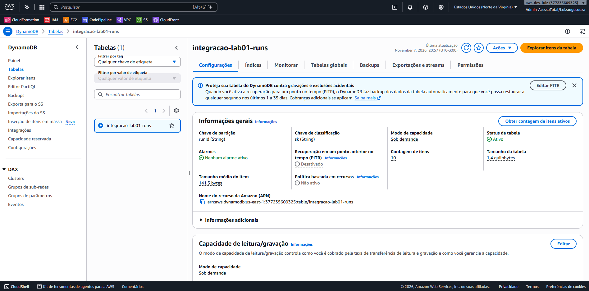

*Figura 1 — Tabela de log de processo no DynamoDB: chave de partição runId, chave de classificação sk e capacidade sob demanda.*

---

## Etapa 2 — Cognito (autenticação)

**Objetivo:** autenticar operadores e leitores. O **Amazon Cognito User Pool** é um diretório de usuários que também funciona como provedor OpenID Connect/OAuth 2.0. O dashboard usa o **Authorization Code Flow com PKCE**, adequado a SPA porque **não há segredo** no navegador.

**Dependências:** nenhuma para criar. O CloudFront/domínio da etapa 10 é necessário só para a URL de retorno (já definida: `<URL_DASHBOARD>/`).

### 2.1 Glossário (leia antes de copiar valores)

| Termo | O que é | Exemplo (formato) | Onde usar |
|---|---|---|---|
| **User Pool ID** | Identificador do diretório | `<REGIAO>_AbCdEfGhI` | Só compõe o Issuer |
| **Client ID** | Identificador público do App Client | 26 caracteres alfanuméricos | Audience do autorizador; `COGNITO_CLIENT_ID` |
| **Issuer URL** | Quem emite o token (`iss`) | `https://cognito-idp.<REGIAO>.amazonaws.com/<USER_POOL_ID>` | Autorizador JWT |
| **Domínio Cognito** | Endereço das páginas de login e do endpoint de token | `https://<prefixo>.auth.<REGIAO>.amazoncognito.com` | `COGNITO_DOMAIN` |
| **Código de autorização** | Valor **de uso único e curto** devolvido na URL após o login (`?code=...`) | — | Trocado por tokens (feito pelo `app.js`) |
| **Access Token** | JWT que autoriza chamadas à API; contém `cognito:groups`, `client_id`, `scope`, `token_use=access` | JWT | **É o token enviado ao API Gateway** |
| **ID Token** | JWT com identidade (e-mail etc.) | JWT | Só exibição no dashboard; não é usado na API |
| **Refresh Token** | Permite obter novos Access/ID tokens sem novo login | — | Renovação silenciosa |

Importante: **User Pool ID ≠ Client ID ≠ código de autorização ≠ token**. O Issuer usa o User Pool ID; o Audience usa o Client ID; a API recebe o Access Token.

### 2.2 Criar o User Pool pelo assistente de SPA

Caminho: **Amazon Cognito → Grupos de usuários (User pools) → Criar grupo de usuários (Create user pool)**.

| Campo | Valor |
|---|---|
| Tipo de aplicação (Application type) | **Aplicação de página única (SPA) (Single-page application)** |
| Nome da aplicação (Name your application) | `<PREFIXO>-app` (nomeia o **App Client**) |
| Opções para identificadores de login (Options for sign-in identifiers) | somente **E-mail (Email)** |
| Autorregistro (Self-registration) | **Desmarcado** |
| Atributos obrigatórios para inscrição | `email` |
| URL de retorno (Return URL) | `<URL_DASHBOARD>/` (se o assistente aceitar; senão deixe em branco e configure na seção 2.7) |

Clique em **Criar diretório de usuários**. Na tela seguinte (exemplos de código React/Angular/JavaScript) **não copie nada**: o projeto já tem `frontend/`. Clique em **Ir para a visão geral**.

**O que acontece:** o Cognito cria o User Pool e um App Client **público (sem Client Secret)**. O assistente pode atribuir um nome automático (`User pool - xxxx`) ao pool.

### 2.3 Renomear o User Pool

1. **Visão geral** do pool → **Renomear (Rename)**.
2. Nome: `<PREFIXO>-pool` → salvar. Renomear **não** muda ID nem ARN: não recrie o pool.

### 2.4 Login por e-mail e autorregistro desabilitado

Conferir em **Autenticação → Inscrição (Authentication → Sign-up)**:

| Opção | Valor |
|---|---|
| Autorregistro (Self-service sign-up) | **Desabilitado** |
| Atributos para login (Sign-in) | E-mail como identificador |
| Verificação de atributo (Attribute verification) | E-mail verificado para recuperação conforme o assistente |

Usuários são criados **apenas pelo administrador** (seção 2.6).

### 2.5 Grupos `operador` e `leitor`

Caminho: User pool → **Gerenciamento de usuários (User management) → Grupos → Criar grupo**.

| Campo | `operador` | `leitor` |
|---|---|---|
| Nome do grupo (Group name) | `operador` | `leitor` |
| Descrição | `Pode consultar e publicar eventos` | `Somente consulta` |
| Precedência (Precedence) | vazio | vazio |
| Perfil do IAM (IAM role) | **nenhum** | **nenhum** |

**O que acontece:** os grupos passam a ser emitidos na claim `cognito:groups` do Access Token e do ID Token. Sem perfil IAM, o grupo **não** concede acesso a serviços AWS: a autorização é feita pela Lambda (`pub-fn`/`read-fn`), que lê essa claim.

### 2.6 Usuários, grupos e primeira alteração de senha

Caminho: **Gerenciamento de usuários → Usuários → Criar usuário (Create user)**.

| Campo | Valor |
|---|---|
| Tipo de convite (Invitation message) | **Enviar um convite por e-mail (Send an email invitation)** ou definir senha manualmente |
| Endereço de e-mail | e-mail de teste sob seu controle (um para operador, outro para leitor) |
| Marcar e-mail como verificado | Marcado |
| Senha temporária (Temporary password) | **Gerar uma senha** (ou definir; nunca registrar em arquivo) |

Depois: **Grupos → operador → Adicionar usuário ao grupo (Add user to group)** e escolha o usuário operador; repita para `leitor`.

**Primeiro login:** o status do usuário fica **Forçar alteração de senha (FORCE_CHANGE_PASSWORD)**. No primeiro login pelo dashboard o Cognito mostra a tela **Alterar senha (Change password)**: informe **Nova senha (New password)** e **Confirmar (Confirm)** conforme a política exibida. Depois o status passa a **Confirmado (Confirmed)**.

### 2.7 Domínio do Cognito e páginas de login

Sem domínio, o endpoint `/oauth2/authorize` e o `/oauth2/token` **não existem**.

Caminho: User pool → **Branding → Domínio (Domain)** (em consoles antigos: **App integration → Domain name**) → **Ações (Actions) → Criar domínio do Cognito (Create Cognito domain)**.

| Campo | Valor |
|---|---|
| Prefixo do domínio (Domain prefix) | `<PREFIXO>-<sufixo-único>` — minúsculas, números e hífens; **não pode conter** `aws`, `amazon` ou `cognito`; precisa ser único na região |
| Versão de branding (Branding version) | **Login gerenciado (Managed login)** (padrão atual) |

**O que acontece:** o Cognito reserva `https://<prefixo>.auth.<REGIAO>.amazoncognito.com`. Esse é o valor de `COGNITO_DOMAIN` (sem barra no final).

Com **Managed login**, o App Client precisa ter um **estilo de branding (branding style)** atribuído; o assistente de SPA normalmente cria e associa um. Verifique em **Branding → Login gerenciado (Managed login) → Estilos**. Se o login mostrar erro de estilo/página indisponível, crie um estilo **sem personalizações** e associe ao App Client, ou use **Hosted UI (clássico)** ao criar o domínio.

### 2.8 Configurar o App Client para Authorization Code + PKCE

Caminho: **Aplicações → Clientes da aplicação (App clients) → `<PREFIXO>-app`**.

**a) Aba Páginas de login (Login pages) → Editar (Edit)**

| Campo | Valor |
|---|---|
| URLs de retorno permitidas (Allowed callback URLs) | `<URL_DASHBOARD>/` (**com** a barra final; deve ser **idêntica** a `REDIRECT_URI` em `config.js`) |
| URLs de saída permitidas (Allowed sign-out URLs) | `<URL_DASHBOARD>/` |
| Provedores de identidade (Identity providers) | **Diretório do grupo de usuários do Cognito (Cognito user pool directory)** |
| Tipos de concessão OAuth 2.0 (OAuth 2.0 grant types) | **Concessão de código de autorização (Authorization code grant)** — **somente esta** |
| Escopos OpenID Connect | `openid`, `email`, `profile` |
| Escopos personalizados | nenhum |

> Não marque **Concessão implícita (Implicit grant)**: devolve tokens na URL e é desaconselhado. Não use fluxos de senha no JavaScript. Para testes locais você pode acrescentar `http://localhost:8080/` às URLs; remova depois.

**b) Aba Informações do cliente da aplicação (App client information) → Editar**

| Campo | Valor recomendado |
|---|---|
| Segredo do cliente (Client secret) | **Nenhum** (precisa continuar `-`; não é possível adicionar depois) |
| Fluxos de autenticação (Authentication flows) | Manter os padrões do assistente; **`ALLOW_REFRESH_TOKEN_AUTH` precisa estar habilitado** (necessário à renovação) |
| Expiração do token de atualização (Refresh token expiration) | `1` dia |
| Expiração do token de acesso (Access token expiration) | `60` minutos |
| Expiração do token de ID (ID token expiration) | `60` minutos |
| Rotação do token de atualização | desabilitada (o `app.js` aceita ambos) |
| Enable token revocation | habilitado (padrão) |

**O que acontece ao salvar:** o Cognito passa a aceitar o `redirect_uri` informado e a emitir código de autorização para esse client. Se `redirect_uri` divergir **um caractere** (barra final, `http` vs `https`), o login falha com `redirect_mismatch`.

### 2.9 Onde pegar os valores que irão para o dashboard

| Valor | Local no Console | Destino |
|---|---|---|
| `COGNITO_DOMAIN` | Branding → Domínio | `config.js` |
| `COGNITO_CLIENT_ID` | Aplicações → Clientes da aplicação | `config.js` e Audience do autorizador |
| `<USER_POOL_ID>` | Visão geral | Issuer do autorizador |

### 2.10 Resultado esperado

- User Pool `<PREFIXO>-pool` em <REGIAO>.
- App Client `<PREFIXO>-app` com **Segredo do cliente: `-`**.
- Grupos `operador` e `leitor`; um usuário em cada.
- Domínio Cognito criado; callback e sign-out = `<URL_DASHBOARD>/`; somente **Authorization code grant**.

### 2.11 Erros comuns

| Sintoma | Causa provável | Correção |
|---|---|---|
| `redirect_mismatch` na tela de login | URL de retorno diferente da cadastrada | Igualar `REDIRECT_URI` e a URL cadastrada (barra final inclusa) |
| `invalid_scope` | Escopo não habilitado no client | Marcar `openid`, `email`, `profile` na seção 2.8 |
| Página padrão “app client doesn't have a return URL set” | Callback não cadastrado | Seção 2.8 (a) |
| `invalid_grant` na troca do código | Código reutilizado ou expirado; `code_verifier` diferente | Reiniciar o login; não atualizar a página durante o retorno |
| Erro de CORS no `/oauth2/token` | Domínio errado em `COGNITO_DOMAIN` | Usar exatamente o domínio da seção 2.7 |

**Evidências visuais**

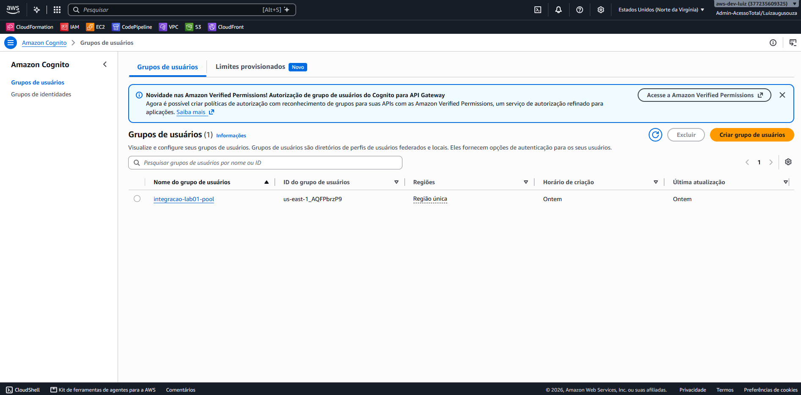

*Figura 2 — Lista de grupos de usuários do Cognito.*

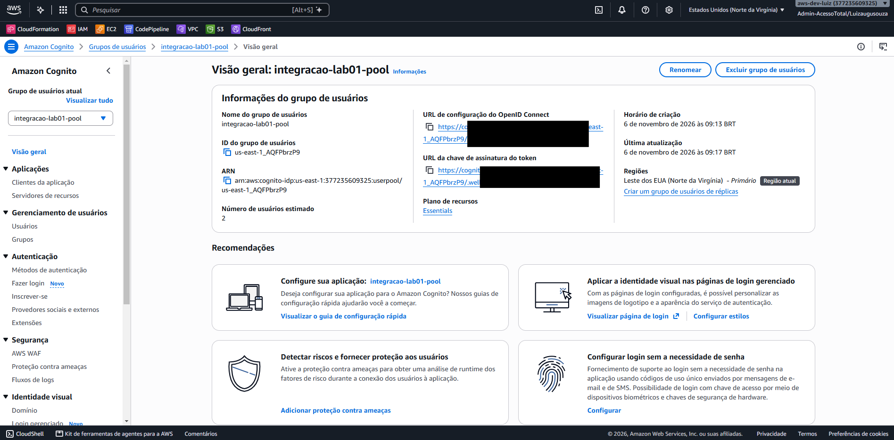

*Figura 3 — Visão geral do grupo de usuários, com ID, ARN e URLs do OpenID Connect.*

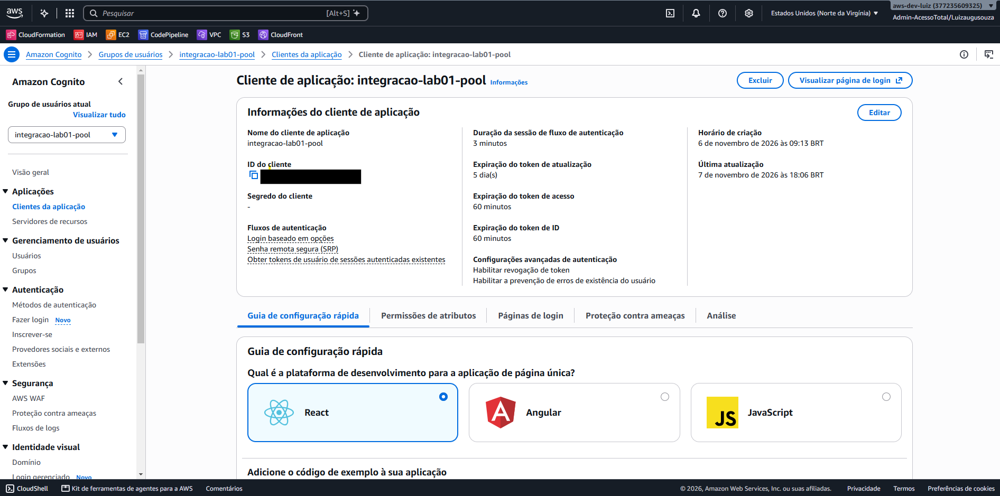

*Figura 4 — Cliente de aplicação do Cognito sem segredo (campo Segredo do cliente vazio) e tempos de expiração dos tokens.*

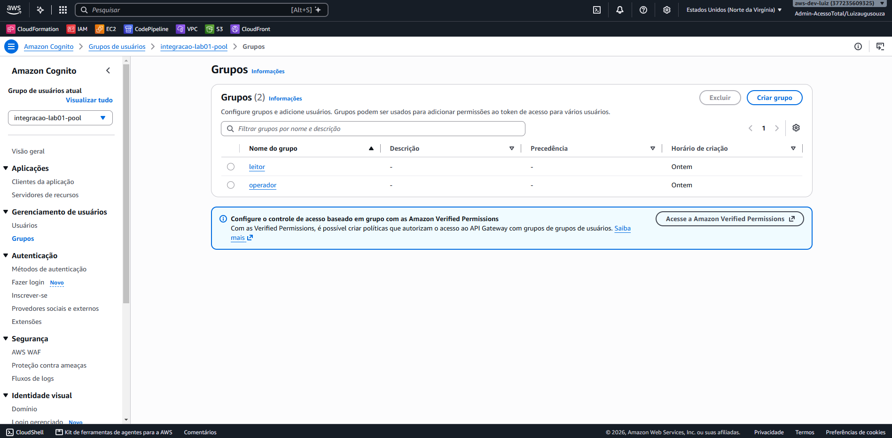

*Figura 5 — Grupos operador e leitor.*

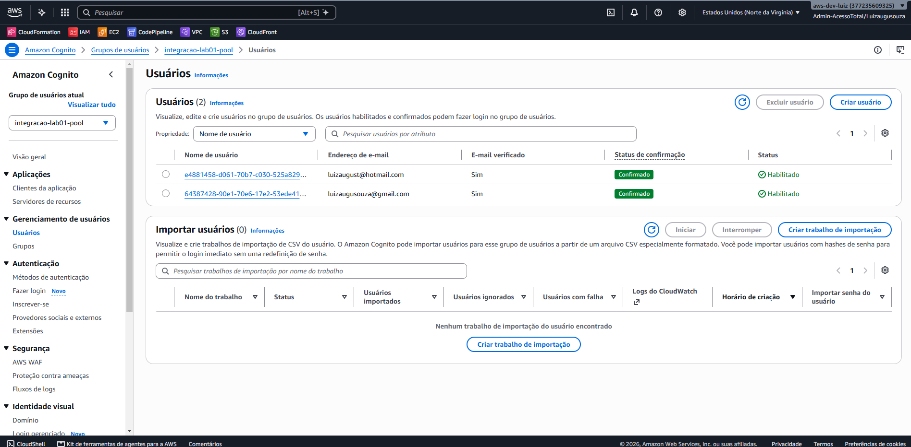

*Figura 6 — Usuários criados no grupo de usuários, com e-mail verificado e status Confirmado.*

---

## Etapa 3 — SQS

**Objetivo:** o Amazon SQS é uma fila de mensagens gerenciada. O projeto usa **três filas Standard** com papéis distintos:

| Fila | Para quê | Quem envia | Quem lê |
|---|---|---|---|
| `<PREFIXO>-proc-queue` | Processamento assíncrono de `order.created` | EventBridge (rule `created`) | `proc-fn` |
| `<PREFIXO>-target-dlq` | **DLQ de target do EventBridge**: guarda eventos que o EventBridge **não conseguiu entregar** a um target | EventBridge | você (inspeção) |
| `<PREFIXO>-proc-dlq` *(nova, recomendada)* | **DLQ de processamento**: guarda mensagens que a `proc-fn` **recebeu e falhou em processar** várias vezes (redrive do SQS) | SQS (redrive da `proc-queue`) | você (inspeção) |

**Diferença essencial:** *falha de entrega* = o evento nem chegou ao destino (permissão, destino inexistente, throttling) → `target-dlq`. *Falha de processamento* = a mensagem chegou à fila mas a Lambda lançou erro → `proc-dlq`. **Não use a mesma fila para os dois**, ou não será possível dizer qual falha ocorreu.

**Caminho:** Console → **Amazon SQS → Filas (Queues) → Criar fila (Create queue)**.

### 3.1 Criar as DLQs primeiro

Para **`<PREFIXO>-target-dlq`** e **`<PREFIXO>-proc-dlq`** (criar):

| Campo | Valor |
|---|---|
| Tipo (Type) | **Padrão (Standard)** |
| Nome (Name) | `<PREFIXO>-target-dlq` / `<PREFIXO>-proc-dlq` |
| Tempo limite de visibilidade (Visibility timeout) | `30` segundos (padrão) |
| Período de retenção de mensagens (Message retention period) | **`14` dias** (máximo; DLQ deve reter mais que a fila de origem) |
| Atraso de entrega (Delivery delay) | `0` |
| Tamanho máximo da mensagem (Maximum message size) | `256 KB` (padrão) |
| Tempo de espera para receber mensagens (Receive message wait time) | `0` |
| Criptografia (Encryption) | **Habilitada**, tipo **Chave gerenciada pelo Amazon SQS (SSE-SQS)** |
| Política de acesso (Access policy) | `target-dlq`: **Avançado** com `iam/resource-policy-target-dlq.json`; `proc-dlq`: Básico (somente proprietário) |
| Política de redrive (Redrive allow policy) | Desabilitado (padrão) |
| Fila de mensagens mortas (Dead-letter queue) | **Desabilitado** (uma DLQ não tem outra DLQ) |
| Tags | `projeto` = `<PREFIXO>` |

> **Nunca use SSE-KMS com a chave gerenciada `aws/sqs`** nas filas que recebem do EventBridge: a política dessa chave não permite o EventBridge. Use **SSE-SQS**.

### 3.2 Fila de processamento `<PREFIXO>-proc-queue`

| Campo | Valor | Por quê |
|---|---|---|
| Tipo | **Padrão** | EventBridge só entrega a filas Standard (ou FIFO com `MessageGroupId`) |
| Nome | `<PREFIXO>-proc-queue` | |
| Tempo limite de visibilidade | **`180` segundos** | Deve ser **≥ 6× o timeout da `proc-fn`** (30 s) para evitar reprocessamento durante a execução |
| Período de retenção | `4` dias (padrão) | |
| Atraso de entrega | `0` | |
| Tamanho máximo da mensagem | `256 KB` | |
| Tempo de espera (long polling) | `0` | O gatilho da Lambda faz seu próprio polling |
| Criptografia | **SSE-SQS** | |
| Política de acesso | **Avançado** → colar `iam/resource-policy-proc-queue.json` (trocando `<ACCOUNT_ID>`) | Permite **somente** a rule `<PREFIXO>-rule-created` enviar |
| Fila de mensagens mortas (Dead-letter queue) | **Habilitado** → ARN de `<PREFIXO>-proc-dlq` | Falha de **processamento** |
| Máximo de recebimentos (Maximum receives) | `3` | Após 3 falhas a mensagem vai à `proc-dlq` |
| Tags | `projeto` = `<PREFIXO>` | |

**O que acontece ao criar:** a fila fica pronta imediatamente. A política de acesso passa a permitir que o EventBridge (principal `events.amazonaws.com`) envie mensagens **apenas** quando originadas daquela rule (condição `aws:SourceArn`). Se o console do EventBridge tentar acrescentar a própria permissão ao criar o target, pode aparecer um segundo statement equivalente: é inofensivo.

**Resultado esperado:** 3 filas Standard, SSE-SQS, `proc-queue` com redrive para `proc-dlq` (3 recebimentos) e visibilidade de 180 s.

**Erros comuns**

| Sintoma | Causa | Correção |
|---|---|---|
| Rule mostra falha de entrega à fila | Queue policy ausente/ARN da rule incorreto | Conferir o ARN: `arn:aws:events:<REGIAO>:<ACCOUNT_ID>:rule/<PREFIXO>-bus/<PREFIXO>-rule-created` |
| Mensagens reprocessadas enquanto a Lambda ainda roda | Visibilidade menor que o timeout | Visibilidade `180` s |
| Criar gatilho da Lambda falha com `InvalidParameterValueException` | Role da Lambda sem permissão SQS | Etapa 5 |

**Evidências visuais**

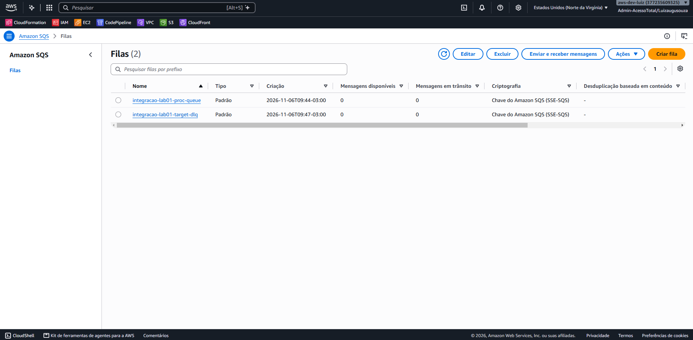

*Figura 7 — Filas SQS Standard com criptografia SSE-SQS: fila de processamento e DLQ de target.*

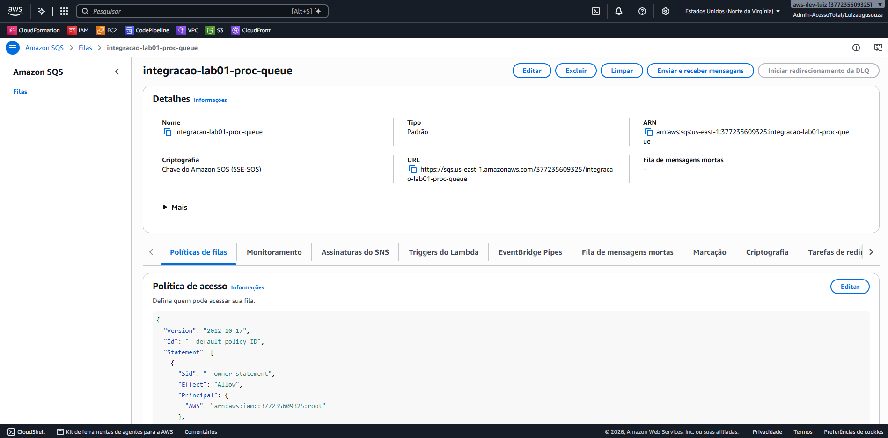

*Figura 8 — Detalhes da fila de processamento e sua política de acesso.*

---

## Etapa 4 — SNS

**Objetivo:** o Amazon SNS publica mensagens para assinantes (e-mail, SMS, filas, funções). No projeto ele é o **destino de notificação** da rule `order.cancelled`.

**Caminho:** Console → **Amazon SNS → Tópicos (Topics) → Criar tópico (Create topic)**.

| Campo | Valor |
|---|---|
| Tipo (Type) | **Padrão (Standard)** |
| Nome (Name) | `<PREFIXO>-notify-topic` |
| Nome de exibição (Display name) | `Pedidos` (opcional) |
| Criptografia (Encryption) | **Desabilitada** (a chave `aws/sns` não permite o EventBridge publicar) |
| Política de acesso (Access policy) | **Avançado**: colar `iam/resource-policy-notify-topic.json` (trocando `<ACCOUNT_ID>`) |
| Política de nova tentativa de entrega, registro de status de entrega, rastreamento ativo | padrão |
| Tags | `projeto` = `<PREFIXO>` |

### Assinatura por e-mail

Dentro do tópico → **Criar assinatura (Create subscription)**.

| Campo | Valor |
|---|---|
| ARN do tópico | `arn:aws:sns:<REGIAO>:<ACCOUNT_ID>:<PREFIXO>-notify-topic` |
| Protocolo (Protocol) | **E-mail (Email)** |
| Endpoint | seu e-mail |
| Política de filtro de assinatura | nenhuma |

**O que acontece:** o SNS envia um e-mail “AWS Notification - Subscription Confirmation”. A assinatura fica **Pendente de confirmação (Pending confirmation)** até você clicar em **Confirm subscription**; depois o status passa a **Confirmado (Confirmed)** (atualize a página). Sem confirmar, **nenhum** e-mail de `order.cancelled` será entregue.

**Resultado esperado:** tópico Standard, sem criptografia, política com o statement do EventBridge, 1 assinatura **Confirmada**.

**Erros comuns**

| Sintoma | Causa | Correção |
|---|---|---|
| Assinatura “Pendente” indefinidamente | E-mail não confirmado / caiu em spam | Reenviar: selecionar a assinatura → **Solicitar confirmação** |
| Rule falha ao publicar | Topic policy sem o statement do EventBridge ou tópico com SSE `aws/sns` | Reaplicar a política; desabilitar a criptografia |

**Evidências visuais**

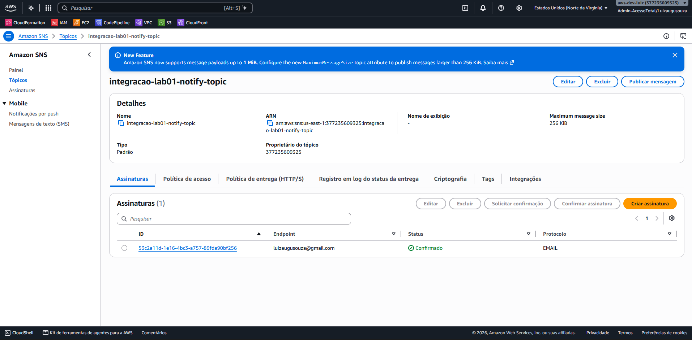

*Figura 9 — Tópico SNS Standard e assinatura por e-mail com status Confirmado.*

---

## Etapa 5 — Lambda e IAM (quatro funções)

**Objetivo:** o AWS Lambda executa código sem servidores. As quatro funções são:

| Função | Papel | Disparada por |
|---|---|---|
| `<PREFIXO>-pub-fn` | Autoriza (grupo `operador`), registra a execução e publica no bus (`POST /runs`) | API Gateway |
| `<PREFIXO>-proc-fn` | Consome a fila e grava evidência `PROCESS#...` | Gatilho SQS (`proc-queue`) |
| `<PREFIXO>-audit-fn` | Target da rule `order.paid`; grava evidência `AUDIT#...` | EventBridge (rule `paid`) |
| `<PREFIXO>-read-fn` | Autoriza (`operador` ou `leitor`) e serve as 4 rotas `GET` | API Gateway |

**Dependências:** tabela DynamoDB (etapa 1) e fila SQS (etapa 3). Bus, rules e API são ligados depois.

### 5.1 Procedimento comum de criação (repita para cada função)

Caminho: Console → **Lambda → Funções (Functions) → Criar função (Create function)**.

1. Selecione **Criar do zero (Author from scratch)**.
2. Preencha os campos da tabela **5.2** da função.
3. Em **Alterar a função de execução padrão (Change default execution role)** escolha **Criar uma nova função com permissões básicas do Lambda (Create a new role with basic Lambda permissions)**. O Console cria a role com a política gerenciada **AWSLambdaBasicExecutionRole**, que dá as permissões de **CloudWatch Logs** (`logs:CreateLogGroup`, `logs:CreateLogStream`, `logs:PutLogEvents`). Anote o nome gerado (`<nome-da-função>-role-xxxxxxxx`).
4. Clique em **Criar função**.

**O que acontece:** a Lambda e a role de execução (IAM) são criadas. A role só tem permissão de log; **as permissões específicas serão adicionadas no passo 5.3**.

### 5.2 Dados de cada função

| Campo | `pub-fn` | `proc-fn` | `audit-fn` | `read-fn` |
|---|---|---|---|---|
| Nome da função | `<PREFIXO>-pub-fn` | `<PREFIXO>-proc-fn` | `<PREFIXO>-audit-fn` | `<PREFIXO>-read-fn` |
| Runtime | **Python 3.12** | Python 3.12 | Python 3.12 | Python 3.12 |
| Arquitetura | `x86_64` (padrão; `arm64` também funciona) | idem | idem | idem |
| Arquivo de código | `src/publisher/handler.py` | `src/processor/handler.py` | `src/auditor/handler.py` | `src/reader/handler.py` |
| Memória | `128` MB | `128` MB | `128` MB | `256` MB |
| Timeout | `10` s | **`30` s** | `10` s | `20` s |
| Política específica | `iam/policy-publisher.json` | `iam/policy-processor.json` | `iam/policy-auditor.json` | `iam/policy-reader.json` |
| Gatilho | API Gateway (etapa 9) | **SQS** `proc-queue` | EventBridge (etapa 6) | API Gateway (etapa 9) |

Tags (todas): `projeto` = `<PREFIXO>`.

### 5.3 Anexar a política específica (IAM)

1. Abra o arquivo `iam/policy-<função>.json` no repositório.
2. **Troque `<ACCOUNT_ID>`** pelo ID da conta (12 dígitos) — procure e substitua **todas** as ocorrências no editor. Região: já está `<REGIAO>`.
3. Na Lambda → aba **Configuração (Configuration) → Permissões (Permissions)** → clique no **nome da role** (abre o IAM).
4. **Adicionar permissões (Add permissions) → Criar política em linha (Create inline policy)** → aba **JSON** → apague tudo e cole o JSON → **Avançar (Next)**.
5. **Nome da política (Policy name):** `<PREFIXO>-pub-fn-policy` (e análogos `proc-fn`, `audit-fn`, `read-fn`) → **Criar política**.

> Os arquivos de `iam/` são **JSON puro e válidos**. Não existe mais campo `comment`: o IAM rejeita atributos desconhecidos.

**Política básica de CloudWatch Logs.** A política gerenciada **AWSLambdaBasicExecutionRole** (criada no passo 5.1) é suficiente. Se preferir restringir aos grupos de log do projeto, substitua-a pela política em linha `iam/policy-lambda-basic-logs.json` (também com `<ACCOUNT_ID>`).

**Resumo das permissões por função**

| Função | Pode | Não pode |
|---|---|---|
| `pub-fn` | `events:PutEvents` só no bus do lab; `PutItem`/`UpdateItem` na tabela | ler a tabela, usar outro bus |
| `proc-fn` | Receber/apagar/alterar visibilidade na `proc-queue`; `PutItem` | publicar eventos, ler outras filas |
| `audit-fn` | `PutItem` | qualquer outra coisa |
| `read-fn` | `Query`/`Scan`/`GetItem`; `logs:FilterLogEvents` no log group `/aws/events/<PREFIXO>`; `cloudwatch:ListMetrics`/`GetMetricData` (não aceitam restrição por recurso, por isso `Resource: *`); `sqs:GetQueueUrl`/`GetQueueAttributes` na `target-dlq` | gravar em qualquer lugar |

### 5.4 Inserir o código e definir o handler

**Opção A (recomendada, pelo editor do Console):**

1. Aba **Código (Code)** → no editor abra `lambda_function.py` (arquivo padrão).
2. Apague o conteúdo e **cole o conteúdo integral** do `handler.py` da função (tabela 5.2).
3. Role até **Configurações de runtime (Runtime settings)** → **Editar (Edit)** → **Manipulador (Handler)** = **`lambda_function.handler`** → **Salvar**.

   *Por quê:* o Handler é `<arquivo sem .py>.<função>`. O código define a função `handler(event, context)`; o arquivo é `lambda_function.py`. O valor padrão do Console (`lambda_function.lambda_handler`) **não existe** nestes arquivos e causa o erro `Handler 'lambda_handler' missing on module 'lambda_function'`.
4. Clique em **Implantar (Deploy)**. Aguarde “Atualização de código bem-sucedida”.

**Opção B (arquivo .zip, mantém o nome `handler.py`):**

```powershell

**Evidências visuais**

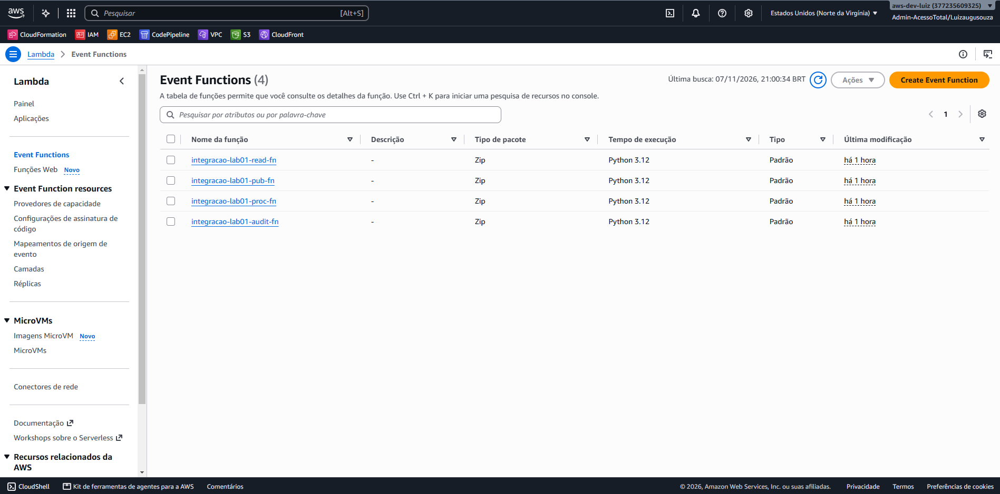

*Figura 10 — As quatro funções Lambda com runtime Python 3.12.*

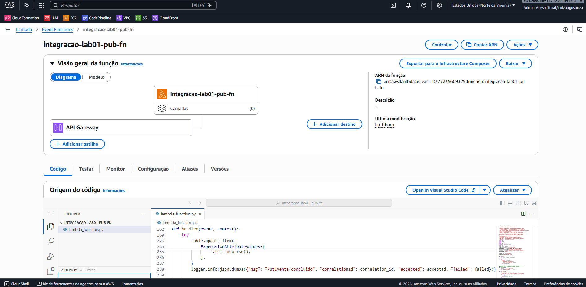

*Figura 11 — Função de publicação (pub-fn), com o API Gateway como gatilho.*

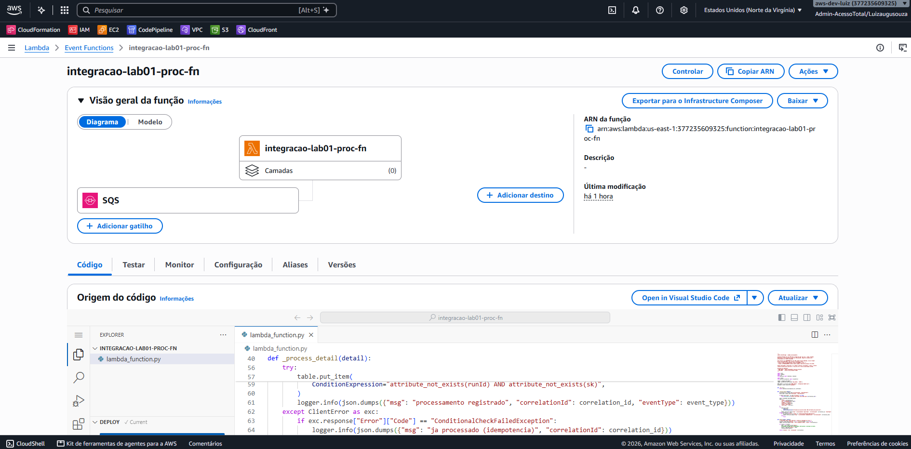

*Figura 12 — Função de processamento (proc-fn), com a fila SQS como gatilho.*

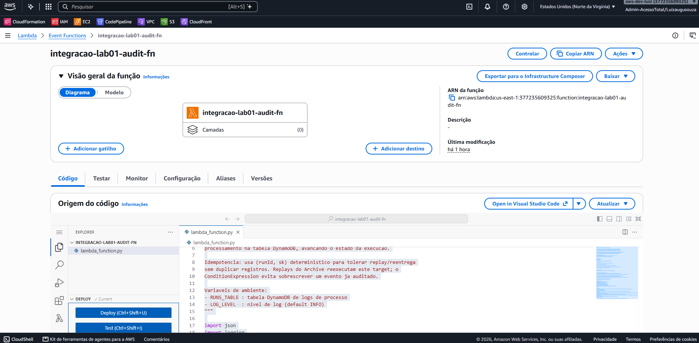

*Figura 13 — Função de auditoria (audit-fn), sem gatilho próprio: é destino de uma regra do EventBridge.*

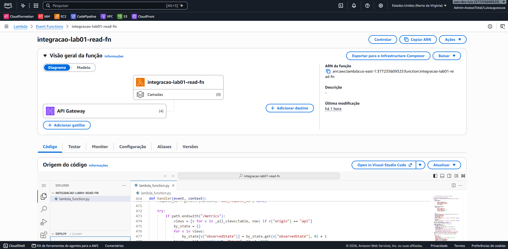

*Figura 14 — Função de leitura (read-fn), com o API Gateway como gatilho.*

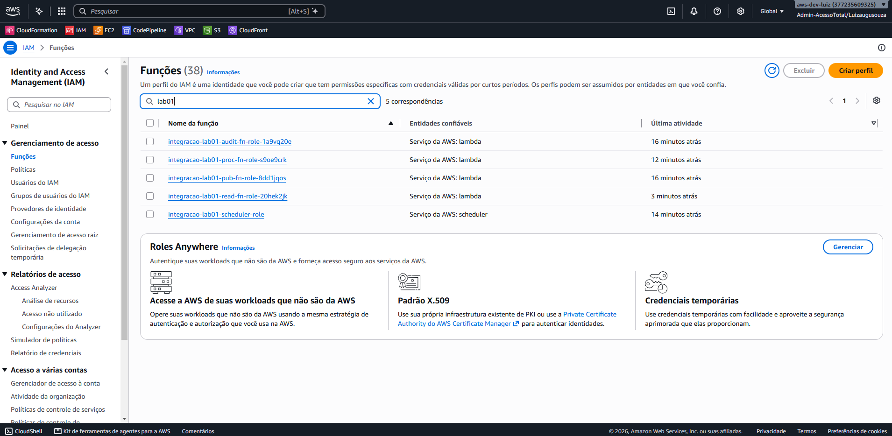

*Figura 15 — Perfis do IAM das funções Lambda e do Scheduler.*

# No PowerShell, a partir da pasta do projeto (exemplo para a publicadora):
Compress-Archive -Path src\publisher\handler.py -DestinationPath $env:TEMP\pub-fn.zip -Force
```

Lambda → **Código → Carregar de (Upload from) → Arquivo .zip** → selecionar → **Salvar**. Handler = **`handler.handler`**.

Use **A ou B**, nunca misture (o Handler deve corresponder ao nome do arquivo).

**Implantar (Deploy) × Publicar versão:** *Deploy* atualiza a versão `$LATEST`, que é a usada pelo API Gateway, pelo gatilho SQS e pelo EventBridge. **Publicar nova versão (Actions → Publish new version)** cria um instantâneo imutável (`1`, `2`…); é opcional neste projeto e **só tem efeito se um alias ou ARN de versão for usado** pelos chamadores. Como todos usam `$LATEST`, o passo obrigatório é **Deploy**. Sem Deploy, o Console continua executando o código antigo.

### 5.5 Variáveis de ambiente

Aba **Configuração → Variáveis de ambiente (Environment variables) → Editar → Adicionar variável de ambiente**.

| Variável | `pub-fn` | `proc-fn` | `audit-fn` | `read-fn` |
|---|---|---|---|---|
| `RUNS_TABLE` | `<PREFIXO>-runs` | idem | idem | idem |
| `EVENT_BUS_NAME` | `<PREFIXO>-bus` | — | — | `<PREFIXO>-bus` |
| `EVENT_SOURCE` | `integracao.lab01.pedidos` | — | — | — |
| `CORS_ORIGIN` | `<URL_DASHBOARD>` | — | — | `<URL_DASHBOARD>` |
| `LOG_LEVEL` | `INFO` | `INFO` | `INFO` | `INFO` |
| `EVENTS_LOG_GROUP` | — | — | — | `/aws/events/<PREFIXO>` |
| `TARGET_DLQ_NAME` | — | — | — | `<PREFIXO>-target-dlq` |
| `RULE_NAMES` | — | — | — | `<PREFIXO>-rule-created,<PREFIXO>-rule-paid,<PREFIXO>-rule-cancelled,<PREFIXO>-rule-payment-failed` |
| `EVIDENCE_GRACE_SECONDS` | — | — | — | `120` |
| `LOGS_LOOKBACK_HOURS` | — | — | — | `24` |

Não há chaves, tokens nem segredos. Mantenha **criptografia padrão** das variáveis.

> `CORS_ORIGIN` só tem efeito quando o CORS do API Gateway **não** está configurado (o API Gateway ignora cabeçalhos CORS da Lambda quando o CORS da API está ativo). Mantém-se por consistência.

### 5.6 Gatilho da `proc-fn` (SQS)

Lambda `proc-fn` → **Adicionar gatilho (Add trigger)**.

| Campo | Valor |
|---|---|
| Fonte | **SQS** |
| Fila SQS | `<PREFIXO>-proc-queue` |
| Tamanho do lote (Batch size) | `5` |
| Janela de lote (Batch window) | `0` |
| Simultaneidade máxima (Maximum concurrency) | vazio |
| Relatar falhas de itens do lote (Report batch item failures) | **desmarcado** (o código não implementa resposta parcial; marcar sem ajustar o código **descartaria** mensagens com falha) |
| Ativar gatilho (Activate trigger) | marcado |

**O que acontece:** o Lambda cria um *event source mapping* e passa a consultar a fila. O Lambda valida as permissões SQS da role neste momento: por isso o passo 5.3 vem antes.

### 5.7 `audit-fn`: permissão do EventBridge

Não há gatilho a criar aqui. Ao adicionar a `audit-fn` como target da rule `paid` (etapa 6) o Console do EventBridge adiciona a **política baseada em recurso** da função. O resultado equivalente está em `iam/resource-policy-audit-fn.json` (visível em Lambda → **Configuração → Permissões → Política baseada em recurso**). Conferir após a etapa 6.

### 5.8 Retenção de logs (custo)

CloudWatch → **Grupos de logs (Log groups)** → `/aws/lambda/<PREFIXO>-*` → **Ações → Editar configuração de retenção** → **1 semana (7 dias)**. Faça também para `/aws/events/<PREFIXO>` (etapa 6).

### 5.9 Resultado esperado

Quatro funções Python 3.12, cada uma com: role própria, política em linha específica, variáveis da tabela 5.5, handler consistente com o arquivo e **Deploy** concluído. `proc-fn` com gatilho SQS **Ativado**.

### 5.10 Erros comuns

| Sintoma | Causa | Correção |
|---|---|---|
| `Runtime.HandlerNotFound` | Handler diferente do arquivo | Seção 5.4 |
| `AccessDeniedException` / `AccessDenied` em `PutItem` | Política sem `<ACCOUNT_ID>` correto ou tabela em outra região | Revisar o ARN |
| `Unable to import module` | Arquivo com nome diferente do esperado no handler | Opção A ou B corretamente |
| Gatilho SQS “Estado: Falha” | Role sem permissões SQS | Anexar `policy-processor.json` |
| `read-fn` devolve `metricas indisponiveis` / `AccessDenied` em CloudWatch | Política antiga da `read-fn` | Substituir pela nova `policy-reader.json` |
| Alterações “não pegam” | Esqueceu **Deploy** | Clicar em **Implantar** |

---

## Etapa 6 — EventBridge (bus, regras, targets)

**Objetivo:** o Amazon EventBridge recebe eventos em um **barramento (event bus)**, avalia **regras (rules)** com **padrões de evento (event patterns)** e entrega os eventos que casam a **destinos (targets)**. Um evento **sem regra correspondente é descartado** (no match) — não é erro.

**Dependências:** SQS (etapa 3), SNS (etapa 4), Lambda `audit-fn` (etapa 5). CloudWatch Logs (6.1).

### 6.1 Criar o log group do target de logs

Console → **CloudWatch → Grupos de logs → Criar grupo de logs (Create log group)**.

| Campo | Valor |
|---|---|
| Nome do grupo de logs | `/aws/events/<PREFIXO>` (o prefixo `/aws/events/` permite que o EventBridge crie a política de recurso automaticamente) |
| Configuração de retenção | **1 semana** |
| Classe do grupo de logs | Standard |

### 6.2 Criar o barramento

Caminho: **Amazon EventBridge → Barramentos (Buses) → Barramentos de eventos (Event buses) → Criar barramento de eventos (Create event bus)**.

| Campo | Valor |
|---|---|
| Nome (Name) | `<PREFIXO>-bus` |
| Descrição | `Barramento de eventos de pedidos` |
| Criptografia (Encryption) | **Usar chave pertencente à AWS (Use AWS owned key)** |
| Arquivar eventos (Archive events) | **Desligado** (o Archive é criado na etapa 8; criar por aqui geraria retenção **indefinida**) |
| Descoberta de esquema (Schema discovery) | Desligado |
| Registro em log (Logging) | Desligado |
| Política baseada em recurso (Resource-based policy) | Manter o padrão (apenas esta conta) |
| Tags | `projeto` = `<PREFIXO>` |

**O que acontece:** o bus aceita `PutEvents` de identidades autorizadas desta conta. O ARN é `arn:aws:events:<REGIAO>:<ACCOUNT_ID>:event-bus/<PREFIXO>-bus`.

### 6.3 Criar as quatro regras

Caminho: **EventBridge → Barramentos → Regras (Rules) → Criar regra (Create rule)**.

**Assistente — passo 1 (Definir detalhes da regra), igual para as 4 regras:**

| Campo | Valor |
|---|---|
| Nome | veja a tabela abaixo |
| Barramento de eventos (Event bus) | `<PREFIXO>-bus` (**não** o `default`) |
| Habilitar a regra no barramento selecionado | Marcado |
| Tipo de regra (Rule type) | **Regra com um padrão de evento (Rule with an event pattern)** |

**Passo 2 (Criar padrão de evento):**

| Campo | Valor |
|---|---|
| Origem do evento (Event source) | **Outros (Other)** (eventos personalizados) |
| Evento de exemplo (Sample event) | opcional: **Insira o seu (Enter my own)** e cole um dos arquivos de `events/` como `detail` |
| Método de criação (Creation method) | **Padrão personalizado (editor JSON) (Custom pattern - JSON editor)** |
| Padrão de evento | conteúdo do arquivo `eventbridge/rule-*.json` |

Opcionalmente clique em **Testar padrão (Test pattern)** para verificar visualmente o JSON (não conta como teste da Parte B).

| Regra | Padrão (arquivo) | Target |
|---|---|---|
| `<PREFIXO>-rule-created` | `eventbridge/rule-order-created.json` | SQS `proc-queue` |
| `<PREFIXO>-rule-paid` | `eventbridge/rule-order-paid.json` | Lambda `audit-fn` |
| `<PREFIXO>-rule-cancelled` | `eventbridge/rule-order-cancelled.json` | SNS `notify-topic` |
| `<PREFIXO>-rule-payment-failed` | `eventbridge/rule-payment-failed.json` | CloudWatch Logs `/aws/events/<PREFIXO>` |

Os arquivos já são **o padrão puro**, prontos para colar. Exemplo (`rule-order-paid.json`):

```json
{
  "source": ["integracao.lab01.pedidos"],
  "detail-type": ["order.paid"],
  "detail": {
    "data": {
      "amount": [{ "numeric": [">", 0] }]
    }
  }
}
```

*O que significa:* só casa eventos com `source` = `integracao.lab01.pedidos`, `detail-type` = `order.paid` e `detail.data.amount` numérico **maior que 0**. O evento `order.unknown` não casa com nenhum dos 4 padrões.

**Passo 3 (Selecionar destinos) — campos comuns:**

| Campo | Valor |
|---|---|
| Tipos de destino (Target types) | **Serviço da AWS (AWS service)** |
| Selecionar um destino | conforme a tabela por regra abaixo |
| **Configurações adicionais (Additional settings)** → Configurar entrada do destino (Configure target input) | **Evento correspondente (Matched events)**, exceto payment.failed |
| Política de nova tentativa (Retry policy) → Idade máxima do evento (Maximum age of event) | `1` hora (`3600` s) |
| Política de nova tentativa → Tentativas de repetição (Retry attempts) | `2` |
| Fila de mensagens mortas (Dead-letter queue) | **Selecionar uma fila do Amazon SQS na conta atual** → `<PREFIXO>-target-dlq` |

Valores equivalentes em `eventbridge/target-retry-dlq.json`.

**Por regra:**

| Regra | Destino | Campo | Valor | Função / execução |
|---|---|---|---|---|
| `rule-created` | **Fila SQS (SQS queue)** | Fila | `<PREFIXO>-proc-queue` | Função de execução: **deixe sem role** (a queue policy da etapa 3 cobre) |
| `rule-paid` | **Função do Lambda (Lambda function)** | Função | `<PREFIXO>-audit-fn`; versão/alias: `$LATEST` | O Console adiciona a política de recurso da função |
| `rule-cancelled` | **Tópico do SNS (SNS topic)** | Tópico | `<PREFIXO>-notify-topic` | Sem role (usa a topic policy) |
| `rule-payment-failed` | **Grupo de logs do CloudWatch (CloudWatch log group)** | Grupo de logs | `/aws/events/<PREFIXO>` | O Console adiciona a política de recurso do CloudWatch Logs |

**Passo 4 (Tags):** `projeto` = `<PREFIXO>`. **Passo 5:** revisar → **Criar regra**.

**O que acontece ao criar:** a regra fica **Habilitada (Enabled)** e passa a avaliar todo evento do bus. Para SQS/SNS/Lambda/Logs o Console tenta anexar a política de recurso do destino; confira se ficou igual a `iam/resource-policy-*.json`. As políticas de recurso são o que **autoriza** o EventBridge: a identidade IAM de quem criou a regra não é usada na entrega.

#### Tabela de permissões por destino (quem autoriza o quê)

| Destino | Mecanismo | Arquivo de referência |
|---|---|---|
| SQS `proc-queue` | Queue policy (resource-based) | `iam/resource-policy-proc-queue.json` |
| SQS `target-dlq` | Queue policy para o EventBridge enviar falhas | `iam/resource-policy-target-dlq.json` |
| SNS | Topic policy | `iam/resource-policy-notify-topic.json` |
| Lambda | Política baseada em recurso da função | `iam/resource-policy-audit-fn.json` |
| CloudWatch Logs | Política de recurso do CloudWatch Logs | `iam/resource-policy-events-logs.json` |

Se o Console **não** criar a política do CloudWatch Logs, aplique-a pelo **CloudShell** (única forma prática; não altera outros recursos):

```bash
aws logs put-resource-policy --policy-name <PREFIXO>-events-to-logs \
  --policy-document file://resource-policy-events-logs.json --region <REGIAO>
```

### 6.4 Input Transformer (somente na regra `payment-failed`)

O **Input Transformer** altera o payload **antes** da entrega: extrai campos com **Caminhos de entrada (Input paths)** e monta uma nova saída com um **Modelo (Template)**. Sem ele, o target recebe o evento original completo.

Na regra `<PREFIXO>-rule-payment-failed`, no passo de destino: **Configurações adicionais → Configurar entrada do destino → Transformador de entrada (Input transformer) → Configurar transformador de entrada (Configure input transformer)**.

| Campo | Valor |
|---|---|
| Evento de exemplo (Sample event) | **Insira o seu (Enter my own)** → colar o envelope abaixo |
| **Caminho de entrada (Input path)** | JSON abaixo |
| **Modelo (Template)** | texto abaixo, **com as aspas externas** |

Input path:

```json
{
  "correlationId": "$.detail.correlationId",
  "orderId": "$.detail.data.orderId",
  "amount": "$.detail.data.amount",
  "reason": "$.detail.data.reason"
}
```

Template:

```text
"[PEDIDOS] Pagamento falhou correlationId=<correlationId> pedido=<orderId> valor=<amount> motivo=<reason>"
```

**Payload original** (o que a regra casa; exemplo):

```json
{
  "version": "0",
  "id": "11111111-2222-3333-4444-555555555555",
  "detail-type": "payment.failed",
  "source": "integracao.lab01.pedidos",
  "account": "<ACCOUNT_ID>",
  "time": "2026-11-07T12:00:00Z",
  "region": "<REGIAO>",
  "resources": [],
  "detail": {
    "schemaVersion": "1.0",
    "correlationId": "lab01-run-abc12345",
    "eventType": "payment.failed",
    "occurredAt": "2026-11-07T12:00:00+00:00",
    "data": { "orderId": "order-2345-04", "amount": 203.6, "reason": "card_declined" }
  }
}
```

**Payload transformado** (o que o log group recebe):

```text
[PEDIDOS] Pagamento falhou correlationId=lab01-run-abc12345 pedido=order-2345-04 valor=203.6 motivo=card_declined
```

Use **Gerar saída (Generate output)** no Console para ver o resultado. A `pub-fn` agora grava `data.reason` em eventos `payment.failed` (antes não gravava, e `<reason>` ficaria vazio).

> **Importante para o dashboard:** a `read-fn` procura `correlationId=<id>` nas linhas do log group para provar o destino de logs. **Não remova `correlationId` do template.**

### 6.5 Resultado esperado (verificação visual)

- Bus `<PREFIXO>-bus` visível.
- 4 regras **Habilitadas** no bus correto, cada uma com 1 target, retry 2 / 1 hora e DLQ `target-dlq`.
- A regra `payment-failed` mostra o Input Transformer no target.
- Políticas de recurso conferidas.

### 6.6 Erros comuns

| Sintoma | Causa | Correção |
|---|---|---|
| Regra criada no bus `default` | Esqueceu de trocar o barramento | Excluir e recriar no bus certo (não é possível mover) |
| Target SQS/SNS mostra falhas | Falta política de recurso ou ARN da regra errado | Etapas 3/4 |
| Pattern não casa | Maiúsculas/minúsculas ou `detail-type` diferente | Os valores são sensíveis a maiúsculas: `order.paid` |
| Input Transformer com `<reason>` vazio | Eventos antigos sem `data.reason` | Usar o `pub-fn` atualizado |
| DLQ com permissão negada | Falta queue policy da `target-dlq` | `resource-policy-target-dlq.json` |

**Evidências visuais**

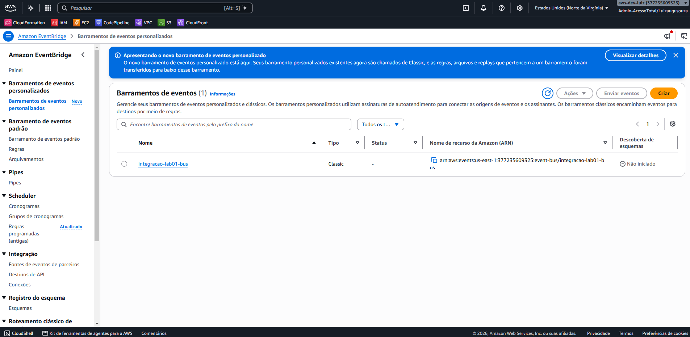

*Figura 16 — Barramento de eventos personalizado.*

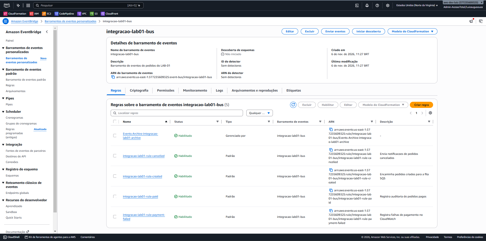

*Figura 17 — Regras do barramento, incluindo a regra gerenciada pelo Archive.*

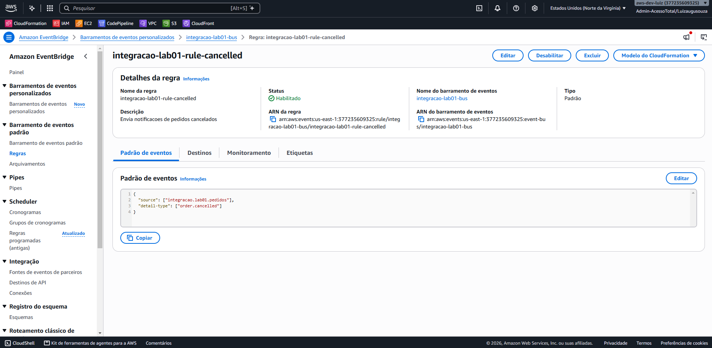

*Figura 18 — Padrão de eventos da regra de cancelamento.*

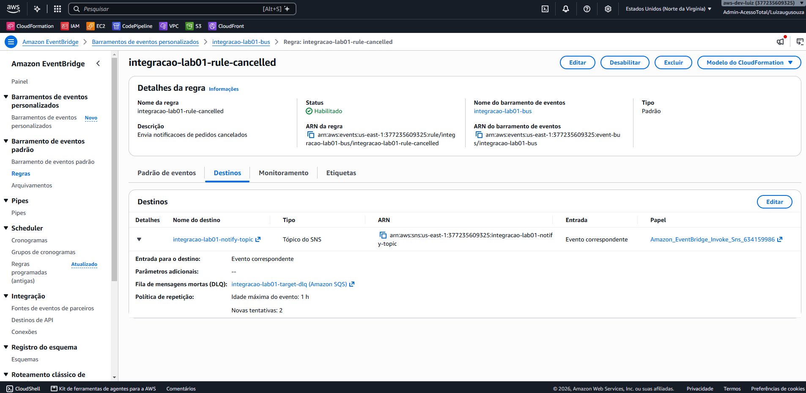

*Figura 19 — Destino da regra de cancelamento: tópico SNS, DLQ de target e política de repetição (2 tentativas, 1 hora).*

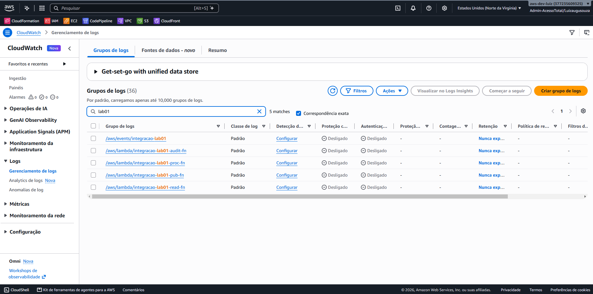

*Figura 20 — Grupos de logs do CloudWatch usados pelo projeto, incluindo o destino das regras.*

---

## Etapa 7 — EventBridge Scheduler

**Objetivo:** o **EventBridge Scheduler** dispara uma ação **por tempo** (`rate` ou `cron`). Uma **regra de evento** dispara **por padrão de evento**. Aqui o Scheduler publica periodicamente um `order.created` no bus, que a regra `created` encaminha à fila.

**Dependências:** bus (etapa 6) e uma **role de execução** que permita `events:PutEvents` no bus.

### 7.1 Criar a role de execução do Scheduler

Caminho: Console → **IAM → Perfis (Roles) → Criar perfil (Create role)**.

| Campo | Valor |
|---|---|
| Tipo de entidade confiável | **Política de confiança personalizada (Custom trust policy)** |
| Política de confiança | `iam/trust-scheduler-role.json` (trocar `<ACCOUNT_ID>`) |
| Adicionar permissões | **não selecione nenhuma** → Avançar |
| Nome do perfil | `<PREFIXO>-scheduler-role` |
| Tags | `projeto` = `<PREFIXO>` |

Depois: abra a role → **Adicionar permissões → Criar política em linha** → JSON de `iam/policy-scheduler-role.json` (trocar `<ACCOUNT_ID>`) → nome `<PREFIXO>-scheduler-putevents`.

**O que acontece:** o serviço `scheduler.amazonaws.com` (restrito à sua conta) pode assumir a role e usá-la **somente** para `events:PutEvents` no bus do projeto.

### 7.2 Criar a agenda

Caminho: **EventBridge → Scheduler → Agendas (Schedules) → Criar agenda (Create schedule)**.

**Passo 1 — Especificar detalhes da agenda**

| Campo | Valor |
|---|---|
| Nome da agenda | `<PREFIXO>-schedule` |
| Descrição | `Publica order.created a cada 10 min (demonstra agenda x regra)` |
| Grupo de agendas (Schedule group) | `default` |
| Ocorrência (Occurrence) | **Agenda recorrente (Recurring schedule)** |
| Fuso horário (Time zone) | `(UTC-03:00) America/Sao_Paulo` (não altera `rate`, mas fixa a leitura de datas) |
| Tipo de agenda (Schedule type) | **Agenda baseada em taxa (Rate-based schedule)** |
| Expressão de taxa (Rate expression) | valor `10`, unidade **minutos (minutes)** → `rate(10 minutes)` |
| Janela de tempo flexível (Flexible time window) | **Desativada (Off)** |
| Período (Timeframe) → Data/hora de início | em branco (começa ao criar) |
| Período → **Data/hora de término** | **defina um término curto** (ex.: 1 dia à frente) para impedir execuções contínuas esquecidas |

**Passo 2 — Selecionar destino**

| Campo | Valor |
|---|---|
| API de destino | **Todas as APIs (All APIs)** → pesquisar **EventBridge** → **PutEvents** (ARN `arn:aws:scheduler:::aws-sdk:eventbridge:putEvents`) |
| Entrada (Input) | JSON abaixo (também em `eventbridge/scheduler-config.json`) |

```json
{
  "Entries": [
    {
      "Source": "integracao.lab01.pedidos",
      "DetailType": "order.created",
      "EventBusName": "<PREFIXO>-bus",
      "Detail": "{\"schemaVersion\":\"1.0\",\"correlationId\":\"lab01-sched-<aws.scheduler.execution-id>\",\"eventType\":\"order.created\",\"occurredAt\":\"<aws.scheduler.scheduled-time>\",\"data\":{\"orderId\":\"order-sched\",\"amount\":99.9}}"
    }
  ]
}
```

Detalhes: `Detail` é uma **string JSON escapada** (aspas internas com `\"`). `<aws.scheduler.execution-id>` e `<aws.scheduler.scheduled-time>` são **atributos de contexto** que o Scheduler substitui a cada disparo; assim cada execução tem `correlationId` **único** (antes ele era fixo, e a idempotência fazia o segundo disparo parecer “sem efeito”).

**Passo 3 — Configurações**

| Campo | Valor |
|---|---|
| Habilitar agenda (Schedule state) | **Habilitar (Enable)** — desabilite depois de validar (ver 7.3) |
| Ação após a conclusão da agenda | **NONE** |
| Política de repetição (Retry policy) | **Habilitada**; idade máxima do evento `1` hora; tentativas `2` |
| Fila de mensagens mortas (DLQ) | **Nenhuma (None)** |
| Criptografia | **Não personalizar (Don't customize encryption settings)** |
| Permissões → Função de execução | **Usar função existente (Use existing role)** → `<PREFIXO>-scheduler-role` |

**Passo 4:** revisar → **Salvar agenda**.

**O que acontece:** a agenda fica **Habilitada** e, a cada 10 minutos (até o término), o Scheduler assume a role, chama `PutEvents` no bus e o EventBridge avalia as regras como em qualquer outro evento. A **região** da agenda é a do console (<REGIAO>); o bus precisa estar na mesma região.

### 7.3 Desativar para evitar custo e execuções contínuas

Scheduler → Agendas → selecionar `<PREFIXO>-schedule` → **Desabilitar (Disable)**. Reabilite só durante o teste V9. O custo do Scheduler é desprezível, mas cada disparo gera eventos, mensagens e execuções de Lambda.

### 7.4 Resultado esperado e erros comuns

**Resultado esperado:** agenda com `rate(10 minutes)`, destino PutEvents no bus, role `<PREFIXO>-scheduler-role`, término definido.

| Sintoma | Causa | Correção |
|---|---|---|
| Agenda dispara mas nada chega | Role sem `events:PutEvents` ou `EventBusName` errado | Revisar política e entrada |
| `ValidationException` ao salvar | `Detail` não é string JSON escapada | Colar o JSON acima sem alterar as barras |
| Eventos só aparecem uma vez | `correlationId` fixo no modelo antigo | Usar `<aws.scheduler.execution-id>` |

**Evidências visuais**

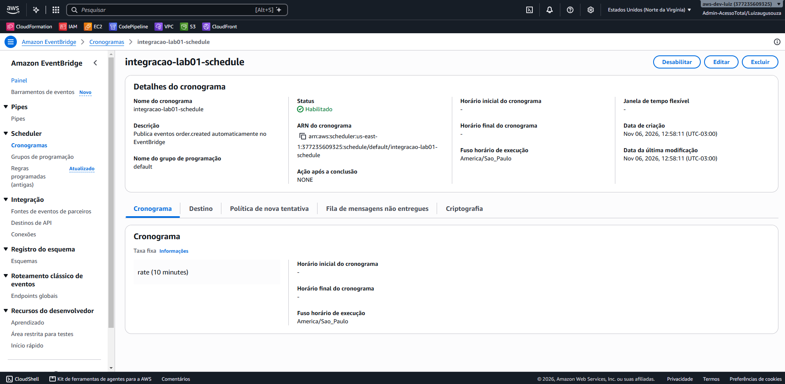

*Figura 21 — Cronograma recorrente rate(10 minutes) do Scheduler.*

---

## Etapa 8 — Archive e Replay (criação do Archive)

**Objetivo:** o **Archive** guarda cópias dos eventos de um bus; o **Replay** reenvia eventos arquivados de uma janela de tempo. Replays produzem **entregas duplicadas** a destinos que não são idempotentes.

**Dependências:** bus (etapa 6).

**Caminho:** **EventBridge → Eventos (Events) → Arquivos (Archives) → Criar arquivo (Create archive)**.

| Campo | Valor |
|---|---|
| Nome | `<PREFIXO>-archive` (não pode ser alterado depois) |
| Descrição | `Eventos de pedidos para replay` |
| Origem (Source) | `<PREFIXO>-bus` (não pode ser alterada depois) |
| Período de retenção (Retention period) | **Dias**, valor **`7`** (não use **Indefinido**) |
| Criptografia (Encryption) | **Usar chave pertencente à AWS** |
| Filtrar eventos (padrão) | `eventbridge/archive-config.json` → campo `EventPattern`: `{"source":["integracao.lab01.pedidos"]}` |

**O que acontece:** o archive fica **Habilitado** e passa a guardar apenas eventos que **entram no bus depois da criação** e que casam com o padrão. A contagem de eventos do archive (`EventCount`) é atualizada com atraso: use-a como indício, não como prova imediata. Após 7 dias os eventos são apagados.

### 8.1 Como será feito o Replay (usado na Parte B)

Caminho: **EventBridge → Eventos → Replays → Iniciar novo replay (Start new replay)**.

| Campo | Valor |
|---|---|
| Nome | `<PREFIXO>-replay-aaaammdd-hhmm` |
| Origem (Source) | archive `<PREFIXO>-archive` |
| Destino (Destination) | barramento `<PREFIXO>-bus` |
| Regras (Rules) | **Regras específicas** (escolha, por exemplo, só `<PREFIXO>-rule-paid`) **ou** todas |
| Intervalo (Time frame) | **Hora de início** e **Hora de término** (verifique o fuso: o console exibe o horário local ou UTC conforme seletor). Use uma janela **estreita** que contenha só os eventos do teste |

**Status do replay:** *Iniciando (Starting)* → *Em execução (Running)* → *Concluído (Completed)*; também *Cancelando*, *Cancelado* e *Falhou (Failed)*. **Concluído significa apenas que o EventBridge terminou de reenviar os eventos ao bus**. Não prova que targets processaram, nem que a idempotência funcionou. A prova exige **comparar os registros no DynamoDB (não duplicados) com os logs dos consumidores** (“já processado/auditado”) — ver teste V11.

Cada evento reenviado contém o campo `replay-name`, o que permite filtrá-lo nos logs.

**Erros comuns**

| Sintoma | Causa | Correção |
|---|---|---|
| Replay conclui com 0 eventos | Janela sem eventos arquivados ou fuso errado | Ampliar/ajustar janela; conferir `EventCount` |
| Nada replicado após criar o archive | Eventos publicados **antes** da criação | Publicar novos eventos |
| Archive “Falhou” | Permissões do usuário/regra | Revisar permissões do implantador |

**Evidências visuais**

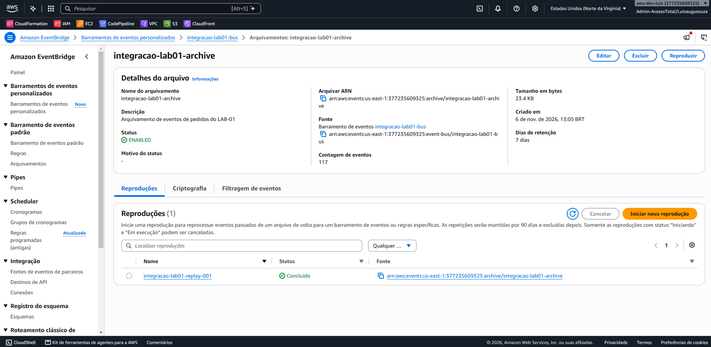

*Figura 22 — Archive com retenção de 7 dias e uma reprodução (Replay) concluída.*

---

## Etapa 9 — API Gateway (HTTP API)

**Objetivo:** o **Amazon API Gateway HTTP API** expõe as rotas HTTPS do dashboard e valida o JWT do Cognito antes de invocar a Lambda.

**Dependências:** `pub-fn` e `read-fn` com código atualizado (etapa 5); User Pool e Client ID (etapa 2).

**Caminho:** Console → **API Gateway → APIs → Criar API (Create API) → API HTTP (HTTP API) → Criar (Build)**. Se a API já existir, **não a recrie**: use esta seção para **conferir e ajustar** cada item.

### 9.1 Criar a API e as integrações

| Campo | Valor |
|---|---|
| Nome da API | `<PREFIXO>-api` |
| Integrações → Adicionar integração | **Lambda** · Região `<REGIAO>` · Função `<PREFIXO>-pub-fn` · Versão do payload **2.0** |
| Integrações → Adicionar integração | **Lambda** · Função `<PREFIXO>-read-fn` · Versão do payload **2.0** |

**Rotas (Configurar rotas):**

| Método | Caminho do recurso | Integração |
|---|---|---|
| `POST` | `/runs` | `pub-fn` |
| `GET` | `/runs` | `read-fn` |
| `GET` | `/runs/{id}` | `read-fn` |
| `GET` | `/runs/{id}/events` | `read-fn` |
| `GET` | `/metrics` | `read-fn` |

**Estágios (Define stages):**

| Campo | Valor |
|---|---|
| Nome do estágio | `$default` |
| Implantação automática (Auto-deploy) | **Habilitada** |

**Revisar e criar.** **O que acontece:** o API Gateway cria a API, as integrações e as rotas, e **adiciona automaticamente a permissão** para invocar cada Lambda (visível na política baseada em recurso da função). Com o estágio `$default`, a URL base **não tem nome de estágio**: `<API_URL>`.

### 9.2 JWT Authorizer

API → **Autorização (Authorization)** → aba **Gerenciar autorizadores (Manage authorizers)** → **Criar (Create)**.

| Campo | Valor |
|---|---|
| Tipo de autorizador | **JWT** |
| Nome | `<PREFIXO>-jwt` |
| Origem da identidade (Identity source) | `$request.header.Authorization` |
| URL do emissor (Issuer URL) | `https://cognito-idp.<REGIAO>.amazonaws.com/<USER_POOL_ID>` |
| Público (Audience) | `<CLIENT_ID>` (Client ID do App Client; **não** o User Pool ID) |

Clique em **Criar**. Em seguida aba **Anexar autorizadores às rotas (Attach authorizers to routes)**: para **cada uma das cinco rotas** selecione a rota → escolha `<PREFIXO>-jwt` → **Anexar autorizador (Attach authorizer)**.

| Campo de rota | Valor |
|---|---|
| Escopos de autorização (Authorization scopes) | **vazio** |

**Sobre escopos e Access Token do Cognito.** O HTTP API valida, para o Access Token do Cognito, a claim **`client_id`** contra o *Audience* (o Access Token não tem `aud`; o API Gateway aceita `aud` ou `client_id`). **Não é necessário configurar escopos** para este projeto, porque a autorização por perfil é feita na Lambda pelas claims `cognito:groups`. *Endurecimento opcional (não aplicado)*: informar o escopo `openid` em cada rota faria o API Gateway rejeitar o ID Token (ele não tem a claim `scope`), forçando o uso do Access Token. A Lambda já exige `token_use=access`.

**O que acontece ao anexar:** toda requisição sem token válido (assinatura, `iss`, `exp`, `client_id`) é recusada **antes** da Lambda: HTTP 401. Com token válido, o API Gateway repassa as claims no evento (`requestContext.authorizer.jwt.claims`), que `pub-fn`/`read-fn` usam para decidir o perfil.

> **Formato da claim de grupos:** no payload 2.0, `cognito:groups` chega como **texto** (ex.: `[operador]`). O código normaliza listas, `[a b]` e `["a","b"]`.

### 9.3 CORS

API → **CORS** → **Configurar (Configure)**.

| Campo | Valor |
|---|---|
| Access-Control-Allow-Origin | `<URL_DASHBOARD>` (clicar em **Adicionar**) — **sem barra final e sem `*`** |
| Access-Control-Allow-Headers | `authorization` e `content-type` (adicionar um por vez) |
| Access-Control-Allow-Methods | `GET`, `POST`, `OPTIONS` |
| Access-Control-Expose-Headers | vazio |
| Access-Control-Max-Age | `300` |
| Access-Control-Allow-Credentials | **Não (No)** (o token vai no cabeçalho, não em cookie) |

**Salvar.** **O que acontece:** o API Gateway responde sozinho ao *preflight* `OPTIONS` e acrescenta os cabeçalhos CORS às respostas. Com CORS configurado na API, os cabeçalhos CORS enviados pela Lambda são ignorados.

Se o dashboard também for aberto pelo domínio padrão do CloudFront (`https://dxxxx.cloudfront.net`), esse **origin** precisaria ser adicionado também. Recomendação: usar **somente** `<URL_DASHBOARD>`.

### 9.4 Limites de uso (throttling)

API → **Estágios (Stages)** → `$default` → **Editar** em **Limitação de rotas (Route throttling)** / configurações padrão de rota:

| Campo | Valor |
|---|---|
| Taxa (Rate) padrão | `5` requisições/s |
| Burst padrão | `10` |
| Rota `POST /runs` (Override) | taxa `1`, burst `3` |

Protege contra disparos ilimitados de eventos. Log de acesso do estágio: **desligado** (evita custo extra) — habilite só se precisar investigar.

### 9.5 Diferença entre 401, 403 e bloqueio CORS

| Resposta | Quem produz | Significado | O que verificar |
|---|---|---|---|
| **HTTP 401** `{"message":"Unauthorized"}` | API Gateway (autorizador) | Token ausente, malformado, expirado, `iss`/`client_id` errados | Header `Authorization: Bearer <access token>`; Issuer; Audience; relógio |
| **HTTP 401** `{"message":"nao autenticado"}` | Lambda | A rota está **sem autorizador** (não chegaram claims) | Anexar o autorizador à rota |
| **HTTP 403** `{"message":"Forbidden"}` | API Gateway | Token válido, mas **escopo** exigido pela rota ausente | Escopos da rota (devem estar vazios) |
| **HTTP 403** com `requiredGroup`/`allowedGroups` | Lambda | Usuário autenticado **sem o grupo necessário** (leitor tentando `POST /runs`) | Grupo do usuário no Cognito |
| **Erro de CORS** no console do navegador | Navegador | A resposta (ou o *preflight*) não trouxe `Access-Control-Allow-Origin` da origem atual; **a requisição pode até ter chegado à API** | Origem exata; headers `authorization`, `content-type`; métodos; abra a aba **Rede/Network** e olhe o `OPTIONS` |
| **HTTP 500/502** | Lambda/integração | Erro interno ou permissão de invocação ausente | Logs da Lambda; política de recurso |

### 9.6 Resultado esperado e erros comuns

**Resultado esperado:** HTTP API `<PREFIXO>-api` · estágio `$default` com implantação automática · 5 rotas, todas com `<PREFIXO>-jwt` · CORS exclusivo do dashboard · throttling configurado.

| Sintoma | Causa | Correção |
|---|---|---|
| 401 mesmo com login | Audience com User Pool ID, ou ID Token no lugar do Access Token | Audience = Client ID; usar Access Token |
| 500 `Internal Server Error` | API Gateway sem permissão de invocação | Reselecionar a função na integração |
| Rota nova não funciona | Autorizador não anexado | 9.2 |
| CORS persiste após ajuste | Valor com barra final / cache de preflight | Remover a barra; aguardar 5 min ou limpar o cache |

**Evidências visuais**

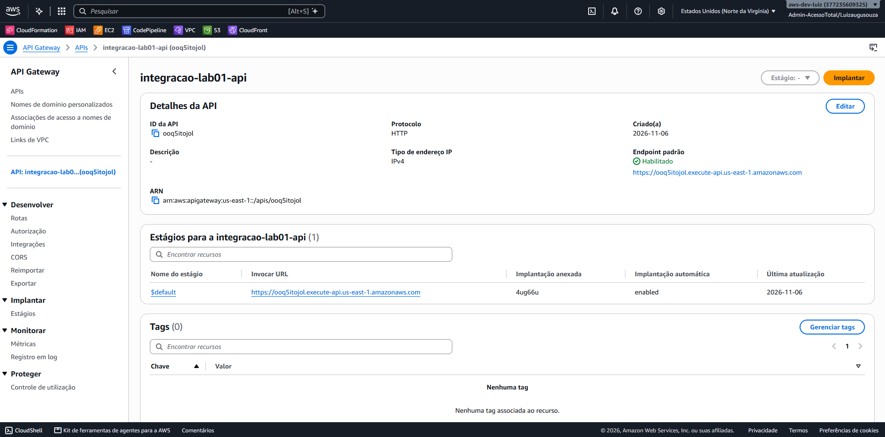

*Figura 23 — Detalhes da HTTP API e do estágio $default com implantação automática.*

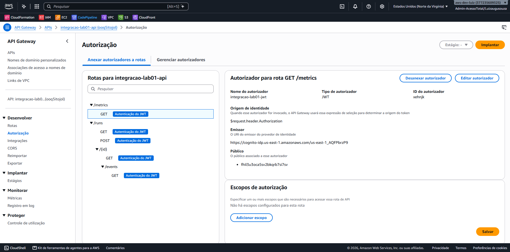

*Figura 24 — Autorizador JWT anexado às rotas da API, sem escopos configurados.*

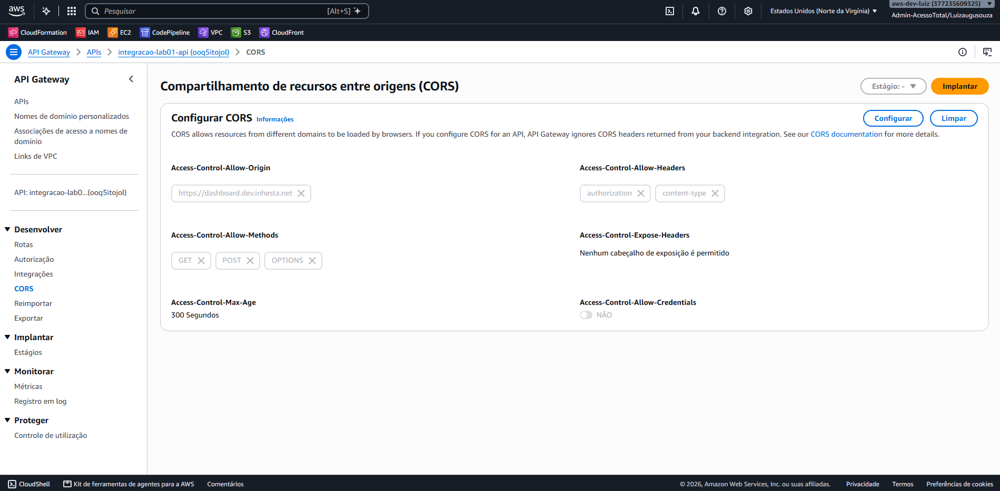

*Figura 25 — Configuração de CORS restrita ao endereço do dashboard.*

---

## Etapa 10 — S3, CloudFront, ACM, Route 53 e dashboard

**Objetivo:** hospedar o dashboard estático em um bucket S3 **privado**, servido por HTTPS via **CloudFront** com **OAC (Origin Access Control)** e domínio `<DOMINIO_DASHBOARD>`.

**Dependências:** domínio em uma zona do Route 53; `config.js` preenchido (etapa 11).

### 10.1 Bucket S3 privado

Caminho: **S3 → Buckets → Criar bucket (Create bucket)**.

| Campo | Valor |
|---|---|
| Tipo de bucket | **Uso geral (General purpose)** |
| Nome do bucket | `<BUCKET>` |
| Região | <REGIAO> |
| Propriedade de objetos (Object Ownership) | **ACLs desabilitadas (recomendado)** |
| **Bloquear todo o acesso público (Block all public access)** | **Marcado** (as 4 opções) |
| Versionamento | Desabilitado |
| Criptografia padrão | **SSE-S3** |
| Chave do bucket (Bucket key) | Habilitada |
| Bloqueio de objeto | Desabilitado |
| Tags | `projeto` = `<PREFIXO>` |

**Não habilite “hospedagem de site estático” do S3**: o CloudFront usa o *endpoint REST* do bucket com OAC.

### 10.2 Enviar os quatro arquivos

1. Antes, edite `frontend/config.js` localmente (etapa 11) — **sem tokens**.
2. Bucket → **Carregar (Upload)** → **Adicionar arquivos** → `index.html`, `app.js`, `config.js`, `styles.css` (na **raiz** do bucket, sem pastas) → **Carregar**.
3. Confira os tipos de conteúdo (**Propriedades** do objeto → Metadados): `text/html`, `text/javascript` (ou `application/javascript`), `text/css`. O Console deduz pela extensão.

### 10.3 Certificado ACM (sempre na região us-east-1)

**AWS Certificate Manager → Solicitar (Request) → Solicitar certificado público**.

| Campo | Valor |
|---|---|
| Nome de domínio totalmente qualificado | `<DOMINIO_DASHBOARD>` |
| Método de validação | **Validação de DNS (DNS validation)** |
| Algoritmo de chave | RSA 2048 (padrão) |

Na página do certificado clique em **Criar registros no Route 53 (Create records in Route 53)** (a zona hospedada precisa estar na mesma conta). Aguarde o status **Emitido (Issued)**. **O certificado usado pelo CloudFront deve ser solicitado em us-east-1**, independentemente de `<REGIAO>`.

### 10.4 Distribuição CloudFront (assistente atual)

Os passos abaixo descrevem o assistente de **Criar distribuição** atual e, depois, os ajustes pós-criação que você deve **conferir** na existente. O assistente muda com frequência (inclusive com **planos de preço**): ao ser exibido um plano, escolha o de menor custo que permita **nome de domínio alternativo e certificado ACM**, e confira os limites antes de confirmar.

Caminho: **CloudFront → Distribuições → Criar distribuição**.

| Passo do assistente | Campo | Valor |
|---|---|---|
| Começar (Get started) | Nome da distribuição | `<PREFIXO>-dashboard` |
| | Tipo de distribuição | **Site ou aplicativo único (Single website or app)** |
| | Domínio personalizado (Custom domain) | `<DOMINIO_DASHBOARD>` (se o Route 53 estiver na conta, o assistente pode criar o registro) |
| Especificar origem (Specify origin) | Tipo de origem | **Amazon S3** |
| | Origem do S3 | bucket `<BUCKET>` (endpoint REST regional, **não** o endpoint de site) |
| | Caminho de origem (Origin path) | vazio |
| | **Permitir acesso privado do S3 ao CloudFront (Allow private S3 bucket access to CloudFront)** | **Marcado** (cria o **OAC**) |
| | Configurações de origem / cache | **Recomendadas (Use recommended)** |
| Habilitar segurança (Enable security) | AWS WAF | **Não habilitar** (custo adicional; fora do escopo) |
| Obter certificado TLS | Certificado | o certificado ACM de `<DOMINIO_DASHBOARD>` |
| Revisar | **Criar distribuição** | — |

**Ajustes pós-criação a conferir** (CloudFront → distribuição → **Geral (General) → Configurações → Editar**):

| Campo | Valor |
|---|---|
| Nomes de domínio alternativos (CNAMEs) | `<DOMINIO_DASHBOARD>` |
| Certificado SSL personalizado | o certificado emitido no 10.3 |
| Política de segurança (Security policy) | `TLSv1.2_2021` (ou superior) |
| **Objeto raiz padrão (Default root object)** | **`index.html`** |
| Versões HTTP | HTTP/2 (e HTTP/3 opcional) |
| Classe de preço (Price class) | Usar somente América do Norte e Europa |

Aba **Comportamentos (Behaviors) → Padrão (Default) → Editar**:

| Campo | Valor |
|---|---|
| Política de protocolo do visualizador | **Redirecionar HTTP para HTTPS** |
| Métodos HTTP permitidos | **GET, HEAD** |
| Política de cache | **CachingOptimized** (TTL padrão de 24 h; por isso é necessário invalidar após cada atualização) |
| Compactar objetos automaticamente | Sim |
| Política de cabeçalhos de resposta (opcional) | `SecurityHeadersPolicy` (gerenciada) |

Aba **Origens (Origins)**: a origem S3 deve usar **Controle de acesso à origem (OAC)**; **não** use OAI nem acesso público.

### 10.5 Política do bucket (OAC)

Se o assistente exibir **Copiar política (Copy policy)**, copie; senão use `iam/bucket-policy-dashboard.json` (trocando `<ACCOUNT_ID>`; o ID da distribuição `<DISTRIBUTION_ID>` já está no arquivo). Bucket → **Permissões (Permissions) → Política do bucket → Editar → colar → Salvar alterações**.

**O que acontece:** somente a distribuição `<DISTRIBUTION_ID>` consegue ler os objetos (`s3:GetObject`); qualquer acesso direto ao bucket continua negado.

### 10.6 Route 53

**Route 53 → Zonas hospedadas (Hosted zones)** → a zona que contém `<DOMINIO_DASHBOARD>` → **Criar registro (Create record)**.

| Campo | Valor |
|---|---|
| Nome do registro | `dashboard` (o prefixo relativo à zona; se a zona for `<DOMINIO_RAIZ>`) |
| Tipo | **A** — IPv4 |
| Alias | **Ativado** |
| Rotear tráfego para | **Alias para distribuição do CloudFront** → escolher `<DISTRIBUTION_ID>` (o domínio `dxxxx.cloudfront.net`) |
| Política de roteamento | Simples |
| Avaliar integridade do destino | Não |

Se a distribuição tiver IPv6 habilitado, crie também um registro **AAAA** com as mesmas opções.

### 10.7 Atualizar o dashboard (rotina)

1. Edite os arquivos de `frontend/` localmente.
2. S3 → bucket → **Carregar** → arquivos (sobrescrevem os de mesmo nome).
3. CloudFront → distribuição → aba **Invalidações (Invalidations) → Criar invalidação** → caminhos `/*` (ou `/index.html /app.js /config.js /styles.css`) → **Criar**. Aguarde **Concluído (Completed)**.
4. No navegador, recarregue sem cache (**Ctrl+F5**). Confirme a nova versão abrindo **DevTools → Rede** e vendo `app.js` carregado.

Sem invalidação, o CloudFront pode servir a versão antiga por até 24 h.

### 10.8 Resultado esperado e erros comuns

**Resultado esperado:** `<URL_DASHBOARD>/` abre o `index.html` por HTTPS; o bucket continua sem acesso público.

| Sintoma | Causa | Correção |
|---|---|---|
| `AccessDenied` XML | Bucket policy ausente/ID da distribuição errado | 10.5 |
| 403 em `/` | Sem objeto raiz | Definir `index.html` |
| Certificado não aparece na lista | ACM fora de us-east-1 | Solicitar em us-east-1 |
| `ERR_NAME_NOT_RESOLVED` | Registro DNS ausente | 10.6 |
| Dashboard antigo | Cache | Invalidar `/*` |
| Console do navegador: violação de CSP | Domínio não previsto em `connect-src` | Ajustar o `<meta http-equiv="Content-Security-Policy">` do `index.html` |

**Evidências visuais**

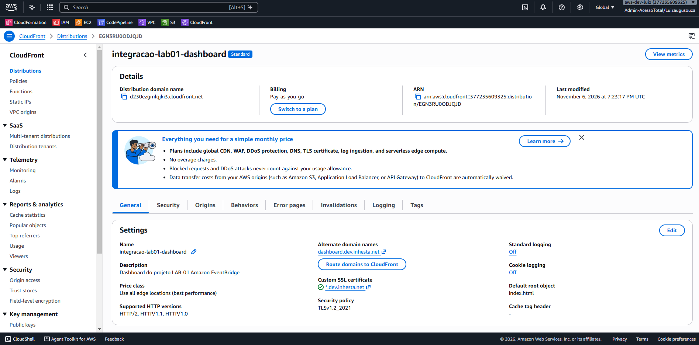

*Figura 26 — Distribuição do CloudFront com domínio alternativo, certificado personalizado e objeto raiz index.html.*

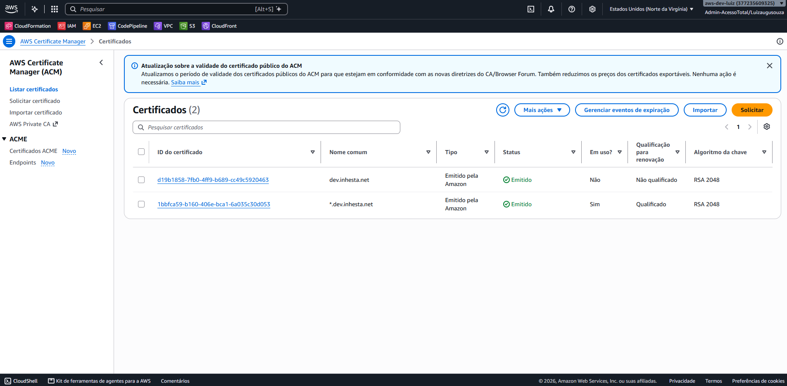

*Figura 27 — Certificados do ACM emitidos.*

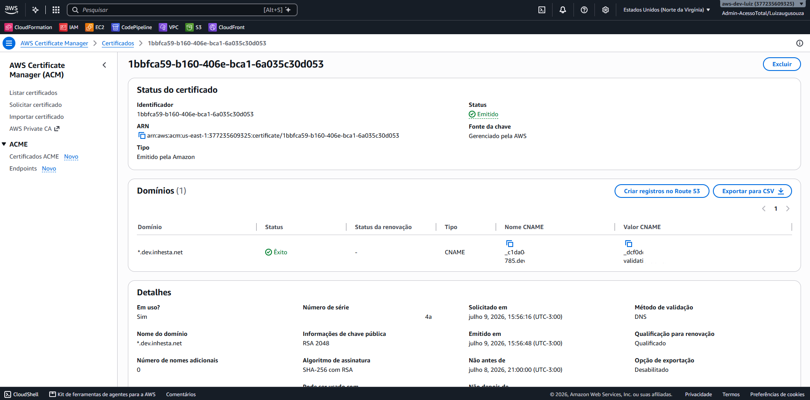

*Figura 28 — Detalhe do certificado do ACM, validado por DNS.*

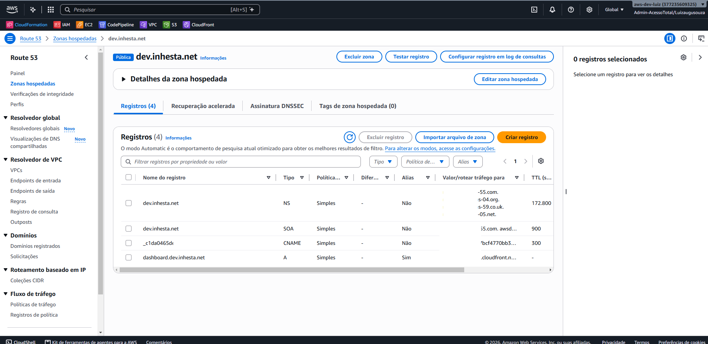

*Figura 29 — Zona hospedada no Route 53 com o registro Alias que aponta para o CloudFront.*

---

## Etapa 11 — Fechamento da integração de login (checklist de valores)

**Objetivo:** ligar o dashboard ao Cognito e à API sem publicar segredos.

**O que o código faz (já implementado em `frontend/app.js`):**

1. Botão **Entrar com Cognito** gera `code_verifier` (aleatório), `code_challenge` (SHA-256, S256), `state` e `nonce`, e redireciona para `COGNITO_DOMAIN/oauth2/authorize`.
2. O Cognito autentica e redireciona para `REDIRECT_URI?code=...&state=...`.
3. O dashboard valida o `state`, troca o código por tokens em `COGNITO_DOMAIN/oauth2/token` com o `code_verifier` (PKCE) e valida o `nonce` do ID Token.
4. O **Access Token** vai no header `Authorization: Bearer ...` a cada chamada. Antes de expirar (margem de 60 s) é renovado com o refresh token; se falhar, a sessão é encerrada.
5. **Sair** apaga a sessão e chama `COGNITO_DOMAIN/logout`.
6. O usuário (e-mail) e o perfil (`operador`/`leitor`) aparecem no painel **Sessão**; o botão de disparo fica desabilitado para quem não é operador (conveniência de interface — a barreira real é o backend).
7. Tokens ficam em `sessionStorage` (apagados ao fechar a aba) e **nunca** são escritos no console, nos logs ou no DOM.

**Sequência para concluir:**

| # | Ação | Onde | Feito |
|---|---|---|---|
| 1 | Criar o domínio do Cognito | Etapa 2.7 | ☐ |
| 2 | Configurar callback, sign-out, Authorization code, escopos | Etapa 2.8 | ☐ |
| 3 | Preencher `COGNITO_DOMAIN` e `COGNITO_CLIENT_ID` em `frontend/config.js` (e confira `API_BASE_URL`, `REDIRECT_URI` e `LOGOUT_URI`) | Repositório | ☐ |
| 4 | Reimplantar `pub-fn` e `read-fn` (código + política + variáveis) | Etapa 5 | ☐ |
| 5 | Conferir autorizador (Issuer/Audience) anexado às 5 rotas e CORS | Etapa 9 | ☐ |
| 6 | Enviar os 4 arquivos ao S3 | Etapa 10.2 | ☐ |
| 7 | Invalidar o CloudFront | Etapa 10.7 | ☐ |
| 8 | Abrir `<URL_DASHBOARD>/` e observar que **não** aparece o banner “MODO DEMONSTRAÇÃO” e que o botão **Entrar com Cognito** está habilitado | Navegador | ☐ |

Exemplo do trecho de `config.js` a preencher (valores públicos; **nunca** token ou senha):

```javascript
COGNITO_DOMAIN: "https://<PREFIXO>-SEUSUFIXO.auth.<REGIAO>.amazoncognito.com",
COGNITO_CLIENT_ID: "SEU_CLIENT_ID_PUBLICO",
```

Neste ponto você só verifica **visualmente** que a tela carrega e o botão existe. **Os testes de login ficam na Parte B.**

**Evidências visuais**

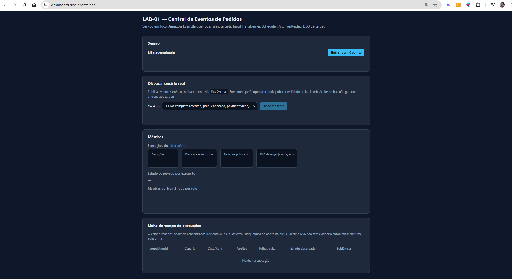

*Figura 30 — Dashboard sem sessão, com o botão Entrar com Cognito.*

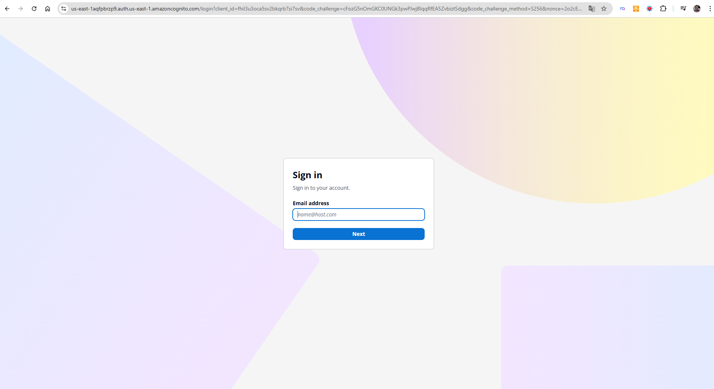

*Figura 31 — Login gerenciado do Cognito: etapa do e-mail.*

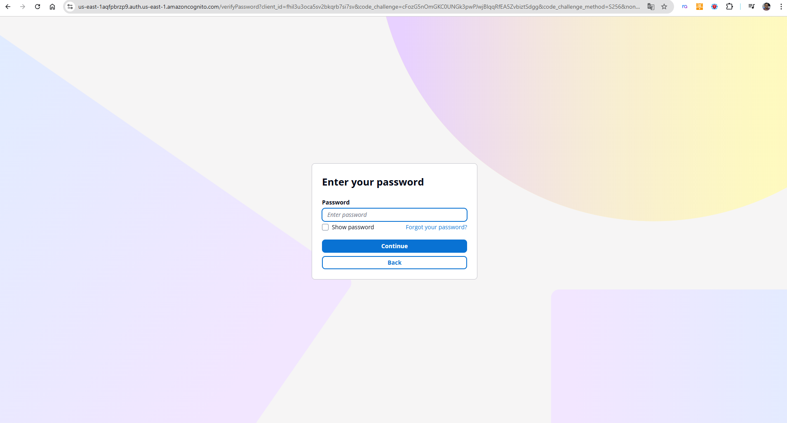

*Figura 32 — Login gerenciado do Cognito: etapa da senha.*

---

# PARTE B — VALIDAÇÃO FINAL

> **Só inicie esta parte quando todas as etapas 0 a 11 estiverem concluídas e conferidas.**
> Regra: um teste só vira **Aprovado** com **evidência registrada** (captura de tela sem dados pessoais/tokens, trecho de log, item do DynamoDB, e-mail recebido etc.). Sem evidência, o resultado permanece **Não executado** ou **Reprovado**.
> Nunca copie tokens, senhas, códigos de autorização ou URLs de retorno com `?code=` para evidências.

### Pré-condições da Parte B

- [ ] Etapa 11 concluída (dashboard publicado, `config.js` com `COGNITO_DOMAIN` e `COGNITO_CLIENT_ID`).
- [ ] Assinatura SNS **Confirmada**.
- [ ] Um usuário em `operador` e outro em `leitor`, ambos já com senha definitiva.
- [ ] Agenda do Scheduler **desabilitada** (será habilitada apenas em V11).
- [ ] CloudWatch → Logs: abas abertas em `/aws/lambda/<PREFIXO>-pub-fn`, `-proc-fn`, `-audit-fn`, `-read-fn` e `/aws/events/<PREFIXO>`.

### Como registrar cada teste

Para cada item registre: **data/hora**, **ação**, **resultado obtido**, **evidência (arquivo/descrição)** e **status** (`Aprovado`, `Reprovado`, `Não executado`). A tabela-resumo está no final da Parte B e começa toda como **Não executado**.

---

## V1 — Autenticação com operador

| Item | Detalhe |
|---|---|
| Ação | Abrir `<URL_DASHBOARD>/` → **Entrar com Cognito** → autenticar com o usuário do grupo `operador` (na primeira vez, definir a nova senha) |
| Esperado | Retorno ao dashboard sem `?code=` na barra de endereços; painel **Sessão** mostra o e-mail, **Perfil: operador** e o horário de expiração; botão **Disparar teste** habilitado; listas carregam (podem estar vazias) |
| Evidência | Captura do painel Sessão (ocultando e-mail) |

**Evidências visuais**

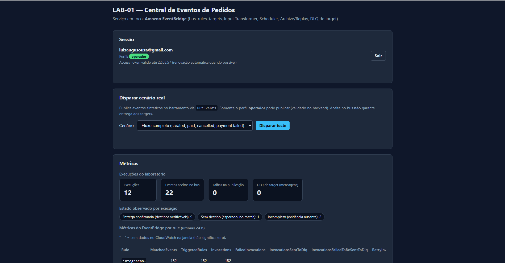

*Figura 33 — Dashboard com sessão do perfil operador.*

## V2 — Autenticação com leitor

| Item | Detalhe |
|---|---|
| Ação | **Sair** → entrar com o usuário do grupo `leitor` |
| Esperado | **Perfil: leitor**; **Disparar teste** **desabilitado** com dica “Somente o perfil operador pode publicar eventos”; execuções e métricas carregam |
| Evidência | Captura do painel Sessão e do botão desabilitado |

**Evidências visuais**

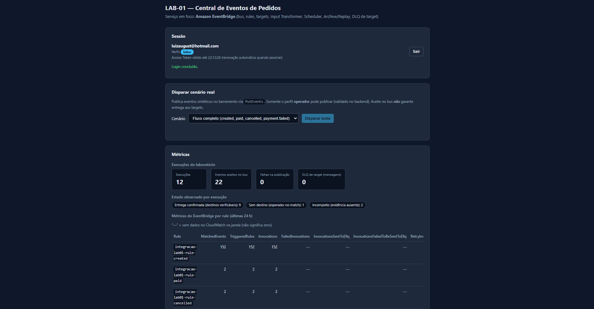

*Figura 34 — Dashboard com sessão do perfil leitor (publicação não permitida).*

## V3 — Logout e sessão

| Item | Detalhe |
|---|---|
| Ação | Clicar em **Sair** |
| Esperado | Redireciona ao Cognito (`/logout`) e volta ao dashboard como **Não autenticado**; `sessionStorage` sem `lab01.session` (DevTools → Aplicativo) |
| Renovação | Mantenha uma sessão aberta além de 60 min: o dashboard deve continuar carregando sem novo login (renovação por refresh token). Se o refresh falhar, deve aparecer “Sessão expirada. Entre novamente.” |
| Evidência | Captura do estado desconectado; (opcional) horário da renovação |

## V4 — Acesso negado sem token

PowerShell (não usa credenciais):

```powershell
try { Invoke-WebRequest -Uri "<API_URL>/runs" -UseBasicParsing }
catch { $_.Exception.Response.StatusCode.value__ }
```

Esperado: **401**. Repita para a rota de publicação (`-Method Post -Uri <API_URL>/runs`): também **401**, e nenhum item `RUN` novo no DynamoDB. Evidência: saída dos comandos.

## V5 — Leitor impedido de publicar (validado no backend)

1. Entre como **leitor** no dashboard.
2. No DevTools → Console execute `copy(JSON.parse(sessionStorage.getItem('lab01.session')).accessToken)` (copia para a área de transferência **sem imprimir**).
3. No PowerShell:

```powershell
$t = Read-Host "Cole o Access Token do LEITOR"   # nao salve em arquivo
try {
  Invoke-RestMethod -Method Post -Uri "<API_URL>/runs" `
    -Headers @{ Authorization = "Bearer $t" } -ContentType "application/json" -Body '{"scenario":"single"}'
} catch { $_.Exception.Response.StatusCode.value__ }
Remove-Variable t
```

Esperado: **403** com `requiredGroup: operador`. No DynamoDB **nenhum** item `RUN` novo. Em seguida o mesmo `GET /runs` com o token do leitor deve devolver **200**. Evidência: código 403, DynamoDB sem novo `RUN`.

## V6 — Publicar cenário `single`

| Item | Detalhe |
|---|---|
| Ação | Como **operador**, escolher **Somente order.created** → **Disparar teste** |
| Esperado | Mensagem “Aceite no bus: 1 evento(s), falhas: 0. correlationId=lab01-run-…”; nova linha na tabela com estado **Aguardando evidência** e, em até ~2 min, **Entrega confirmada (destinos verificáveis)** com evidência `processor / order.created` |
| Evidência | Linha do dashboard, item `PROCESS#order.created` no DynamoDB, log da `proc-fn` |

**Evidências visuais**

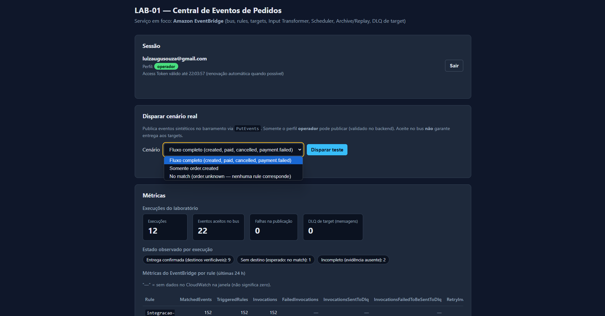

*Figura 35 — Seletor de cenários do dashboard.*

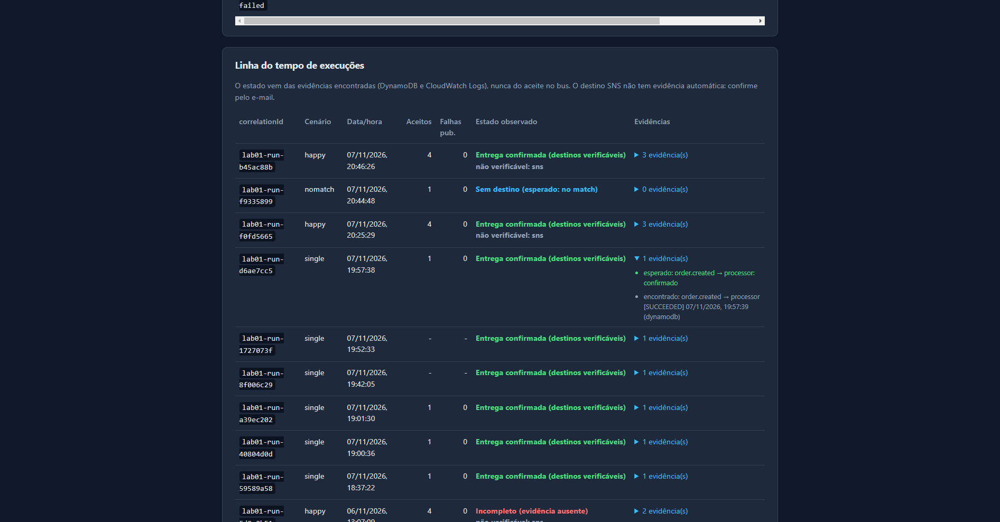

*Figura 36 — Linha do tempo com uma execução single e a evidência confirmada.*

## V7 — Publicar cenário `happy` e recebimento pelos quatro destinos

| Destino | Como comprovar | Esperado |
|---|---|---|
| SQS → `proc-fn` | DynamoDB: item `PROCESS#order.created`; log da `proc-fn` “processamento registrado” | presente |
| Lambda `audit-fn` | DynamoDB: item `AUDIT#order.paid`; log “auditoria registrada” | presente |
| SNS | E-mail com o evento `order.cancelled` na caixa do assinante | recebido (**evidência manual**; o dashboard marca SNS como *não verificável*) |
| CloudWatch Logs | Log group `/aws/events/<PREFIXO>` com a linha `[PEDIDOS] Pagamento falhou correlationId=...` | presente |

Esperado no dashboard: 4 aceitos, 0 falhas; estado **Entrega confirmada (destinos verificáveis)** com `não verificável: sns`; ao expandir **Evidências**: três evidências (processor, auditor, cloudwatch-logs) e o SNS como “não verificável (confirmar manualmente)”.

> Se só 2 de 3 evidências aparecerem, o dashboard mostra **Parcial** (dentro de 120 s) e **Incompleto** (depois). Isso é o comportamento correto — não force `CONFIRMADO`.

**Evidências visuais**

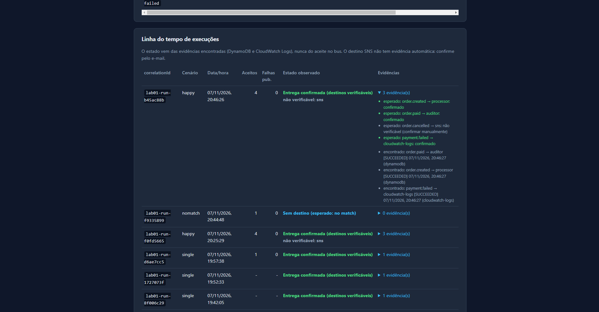

*Figura 37 — Linha do tempo com uma execução happy e as evidências expandidas.*

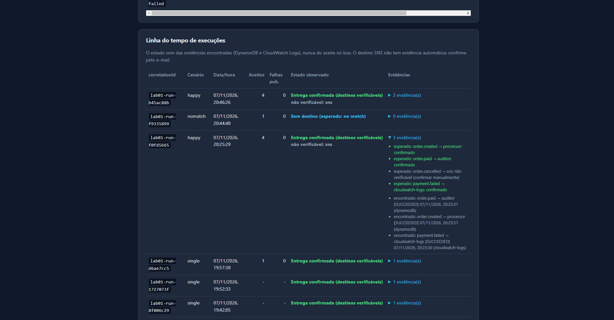

*Figura 38 — Linha do tempo com execuções happy e nomatch.*

## V8 — Cenário `nomatch`

| Item | Detalhe |
|---|---|
| Ação | **No match (order.unknown)** → Disparar |
| Esperado | 1 evento aceito; estado **Sem destino (esperado: no match)**; **zero** evidências; nenhum item `PROCESS#`/`AUDIT#` no DynamoDB; nenhum log novo no log group; métrica `MatchedEvents` não aumenta para este evento |
| Observação | Ausência de evidência **é** o resultado esperado, mas não prova sozinha que nenhuma regra casou. Complemente comparando as métricas `MatchedEvents`/`Invocations` antes e depois |
| Evidência | Linha do dashboard; consulta ao DynamoDB pelo `runId` |

## V9 — Input Transformer

1. Em V7, abra o log group e localize a linha do `payment.failed` do `correlationId` testado.
2. Compare com o **payload original** (EventBridge → Regras → Teste de padrão, ou o evento do `events/payment-failed.json`).

Esperado: o log contém **apenas** o texto transformado `[PEDIDOS] Pagamento falhou correlationId=<id> pedido=<id> valor=<n> motivo=card_declined`, e **não** o envelope JSON original. Evidência: captura do log + o payload original.

## V10 — Scheduler

1. Scheduler → habilitar `<PREFIXO>-schedule` (confirme término curto).
2. Aguarde até 10 min.

Esperado: itens `PROCESS#order.created` no DynamoDB com `runId` `lab01-sched-<uuid>` (sem item `RUN`, pois a publicação não passou pela `pub-fn`); o dashboard lista a linha com cenário **agendado** e estado **Entrega confirmada**; **a cada** disparo um novo `correlationId`.
3. **Desabilite** a agenda ao terminar. Evidência: item no DynamoDB, linha no dashboard, agenda desabilitada.

## V11 — Archive e Replay

1. Garanta eventos recentes (V7). Verifique no Archive que `EventCount` > 0 (pode demorar).
2. Inicie um Replay (etapa 8.1) com janela estreita sobre os eventos do V7, destino o bus e **todas as regras**.
3. Acompanhe: *Iniciando → Em execução → Concluído*.

Esperado: status **Concluído**. **Isto, sozinho, não prova idempotência.** Prossiga para V12. Evidência: tela do Replay (nome, janela, status).

## V12 — Idempotência (depende do V11)

| Verificação | Esperado |
|---|---|
| DynamoDB, query por `runId` do V7 | **Continua** 1 item `PROCESS#order.created` e 1 `AUDIT#order.paid` (não duplicaram; `observedAt` inalterado) |
| Log da `proc-fn` | Mensagem “ja processado (idempotencia)” com o `correlationId` |
| Log da `audit-fn` | Mensagem “evento ja auditado (idempotencia)” |
| Log group `/aws/events/<PREFIXO>` | **Nova** linha para o mesmo `correlationId` (o destino de logs **não** é idempotente; o dashboard mostra `occurrences` > 1 na evidência) |
| E-mail SNS | Novo e-mail (o SNS também **não** é idempotente) |

O teste só é Aprovado se o DynamoDB **não** duplicou e os logs mostram a rejeição pela `ConditionExpression`. Evidência: query do DynamoDB antes/depois e trechos dos logs.

## V13 — Falha de entrega ao target, retry e DLQ de target

Falha segura e reversível:

1. SNS → tópico → **Política de acesso → Editar**: **remova** o statement `PermitirEventBridgeRuleCancelledPublicar` (guarde o JSON original) → salvar.
2. Dispare `happy`.
3. Aguarde alguns minutos.

Esperado: EventBridge tenta entregar ao SNS e falha; após esgotar o retry (2 tentativas, 1 h) — ou imediatamente, se o erro de permissão não for retentável — a mensagem aparece em `<PREFIXO>-target-dlq` (SQS → **Enviar e receber mensagens → Pesquisar mensagens**), com atributos de erro. Métricas da regra `cancelled`: `FailedInvocations` > 0 e `InvocationsSentToDlq` > 0.

Reversão (obrigatória): restaure a topic policy original (`iam/resource-policy-notify-topic.json`) e **esvazie** a `target-dlq` (**Limpar fila / Purge**).

Observação: este teste prova a rota **falha de entrega → DLQ**. Os limites exatos de tentativas/idade só são observáveis com falhas retentáveis (ex.: throttling), que não se reproduz com segurança aqui — registre como limitação se não for observado.

## V14 — DLQ de processamento (diferente da DLQ de target)

1. SQS → `<PREFIXO>-proc-queue` → **Enviar mensagem**, corpo:

```json
{"detail":{"correlationId":"lab01-run-forcefail","eventType":"order.created","data":{"forceFail":true}}}
```

2. A `proc-fn` lançará exceção em cada recebimento (3 vezes).

Esperado: após ~3 recebimentos (e 3 × 180 s de visibilidade, ~9 min) a mensagem vai à `<PREFIXO>-proc-dlq`; a `target-dlq` **não** recebe nada. Evidência: mensagem na `proc-dlq`, logs de erro da `proc-fn`, `target-dlq` vazia. Limpeza: esvaziar a `proc-dlq`.

## V15 — Dashboard, métricas e histórico

| Verificação | Esperado |
|---|---|
| Recarregar a página (F5) | Sessão mantida (mesma aba), lista continua e métricas reaparecem |
| Tabela | Colunas: correlationId, cenário, data/hora, aceitos, falhas pub., estado observado, evidências |
| Métricas de execuções | Total, eventos aceitos, falhas de publicação batem com o DynamoDB |
| Estados | Chips mostram a contagem por estado observado |
| Métricas do EventBridge por rule | Valores reais do CloudWatch; “—” quando não há dado (nunca zero inventado). Compare `MatchedEvents`/`Invocations` com o console do EventBridge |
| DLQ de target | Quantidade de mensagens igual à fila (após V13 e a limpeza: 0) |
| Modo demonstração | Com `MODO_DEMONSTRACAO: true` em `config.js` o banner aparece e **não** há chamada à API; com `false`, só dados reais |

Evidência: capturas e comparação com os consoles.

**Evidências visuais**

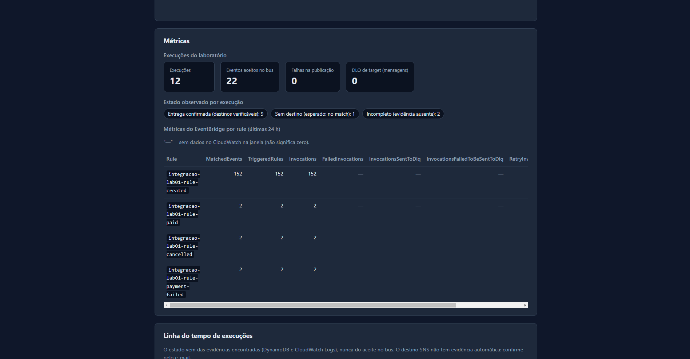

*Figura 39 — Métricas do projeto e do EventBridge por regra.*

## V16 — Custos

1. **Billing → Cost Explorer** (dados com até 24 h de atraso) e **Budgets**: confira que o gasto está dentro do orçamento.
2. **Free Tier**: página de uso do nível gratuito.
3. Confirme **Scheduler desabilitado** e **sem Replay em execução**.

Evidência: captura do Budgets/Cost Explorer.

## V17 — Limpeza (apenas quando o projeto terminar)

Execute a Parte C → **Limpeza**. Evidência: lista dos serviços sem recursos `<PREFIXO>-*`.

---

## Tabela-resumo da validação

| Teste | Descrição | Status | Evidência |
|---|---|---|---|
| V1 | Login operador | Não executado | — |
| V2 | Login leitor | Não executado | — |
| V3 | Logout/renovação | Não executado | — |
| V4 | Sem token → 401 | Não executado | — |
| V5 | Leitor não publica (403 no backend) | Não executado | — |
| V6 | Cenário `single` | Não executado | — |
| V7 | Cenário `happy` e 4 destinos | Não executado | — |
| V8 | Cenário `nomatch` | Não executado | — |
| V9 | Input Transformer | Não executado | — |
| V10 | Scheduler | Não executado | — |
| V11 | Archive/Replay | Não executado | — |
| V12 | Idempotência | Não executado | — |
| V13 | Retry/DLQ de target | Não executado | — |
| V14 | DLQ de processamento | Não executado | — |
| V15 | Dashboard/métricas/histórico | Não executado | — |
| V16 | Custos | Não executado | — |
| V17 | Limpeza | Não executado | — |

---

# PARTE C — TROUBLESHOOTING, CUSTOS E LIMPEZA

## Troubleshooting consolidado

| Sintoma | Causa provável | Correção |
|---|---|---|
| Banner “MODO DEMONSTRAÇÃO” aparece | `API_BASE_URL` vazio, `MODO_DEMONSTRACAO: true` ou `config.js` em cache | Corrigir e invalidar o CloudFront |
| “Autenticação não configurada” | `COGNITO_DOMAIN` ou `COGNITO_CLIENT_ID` vazios | Etapa 11 |
| Login volta com `redirect_mismatch` | Callback diferente | Etapa 2.8 |
| “state divergente” | Aba aberta antes/depois do login, `sessionStorage` limpo | Iniciar novamente pelo botão |
| `invalid_grant` | Código reutilizado | Reiniciar login |
| 401 após login | Issuer/Audience errados; ID Token usado | Etapa 9.2 |
| 403 “perfil sem permissão” | Usuário fora do grupo | Etapa 2.6 |
| 403 “use o Access Token” | Token de ID enviado | Usar Access Token |
| 500 no `POST /runs` | `RUNS_TABLE`/permissões; veja o log da `pub-fn` | Etapa 5 |
| Estado preso em “Aguardando” | Consumidor sem permissão, gatilho SQS desativado | Logs da `proc-fn`/`audit-fn` |
| “Sem evidência” em `payment.failed` | `read-fn` sem `logs:FilterLogEvents`, log group com outro nome, template sem `correlationId=` | Etapas 5 e 6.4 |
| Métricas do EventBridge “—” | Sem eventos na janela, ou sem `cloudwatch:ListMetrics` | Aguardar; revisar a política |
| Target sem entrega | Política de recurso ausente/pattern | Etapa 6 |
| Itens duplicados após replay | Idempotência quebrada | Conferir `ConditionExpression` nos handlers |
| CORS bloqueado | Origem, headers ou métodos | Etapa 9.3 |

## Custos (estimativa e premissas)

Volume baixo e uso pontual em <REGIAO>. **Os valores reais devem ser conferidos no Cost Explorer** (não há medição neste repositório).

| Serviço | Comportamento de custo | Controle |
|---|---|---|
| EventBridge (bus, regras, archive, replay) | Por evento publicado; archive e replay têm preço próprio | Volume mínimo; archive 7 dias; evitar replays amplos |
| Scheduler | Por invocação (há cota gratuita) | Término definido; desabilitar após V10 |
| Lambda, SQS, SNS | Dentro de cotas gratuitas no volume do lab | — |
| DynamoDB | Sob demanda | `Scan` do dashboard é aceitável no volume do lab |
| CloudWatch Logs | Ingestão e armazenamento; consultas `FilterLogEvents` | Retenção de 7 dias |
| CloudFront / S3 | Tráfego mínimo (verifique o plano de preços escolhido) | — |
| Route 53 | Zona hospedada tem custo mensal fixo | Reaproveitar a zona existente |
| ACM | Certificado público gratuito | — |
| API Gateway (HTTP API) | Por milhão de requisições | Throttling configurado |
| Cognito | Cota gratuita de usuários ativos mensais | — |

Alertas do Budgets **não** interrompem gastos.

## Limpeza (executar somente ao final do projeto)

> **Ação destrutiva e irreversível.** Não faça agora. Confirme que não precisa mais de dados nem recursos. Exclua nesta ordem:

1. Desabilitar/excluir a **agenda** do Scheduler e a role `<PREFIXO>-scheduler-role`.
2. Garantir que não há **Replay** em execução.
3. Excluir o **Archive** `<PREFIXO>-archive`.
4. Excluir as **4 regras** (os targets saem junto).
5. Excluir o **bus** `<PREFIXO>-bus`.
6. Excluir a **API** `<PREFIXO>-api` (e o autorizador).
7. Remover o registro do **Route 53** `dashboard`, o **alias** de domínio e o **certificado ACM**.
8. Desabilitar e excluir a **distribuição CloudFront** `<DISTRIBUTION_ID>` (a exclusão só é permitida após a desabilitação ser implantada) e o **OAC**.
9. Esvaziar e excluir o **bucket S3** `<BUCKET>`.
10. Excluir as **3 filas SQS** (`proc-queue`, `proc-dlq`, `target-dlq`).
11. Excluir o **tópico SNS** e a assinatura.
12. Excluir as **4 Lambdas** e suas **roles/políticas IAM**.
13. Excluir a **tabela DynamoDB**.
14. Excluir o **domínio** e o **User Pool** do Cognito.
15. Excluir os **grupos de logs** `/aws/lambda/<PREFIXO>-*` e `/aws/events/<PREFIXO>`, e a política de recurso do CloudWatch Logs criada.
16. Excluir o **orçamento** `<PREFIXO>-orcamento`, se desejar.

**Checagem final:** no Console, filtrar por `<PREFIXO>` em cada serviço e conferir que nada restou; revisar o Cost Explorer no dia seguinte.

---

> Registro cronológico de execução: anote em um arquivo **fora do repositório** (ou no seu caderno de anotações) os resultados reais, sem tokens nem senhas. Não marque nada como concluído sem executar e sem evidência.
