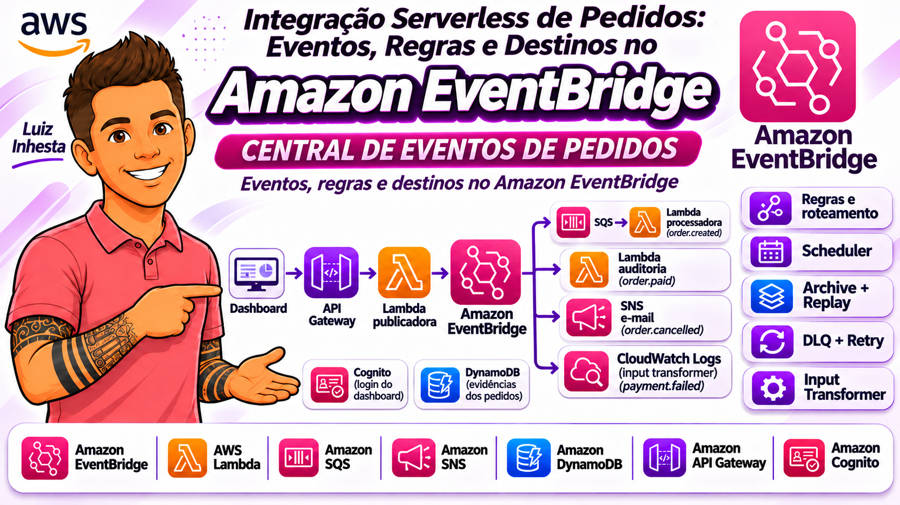
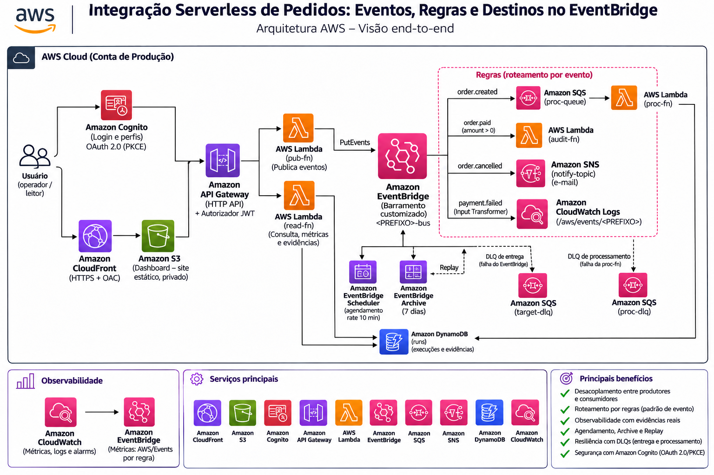
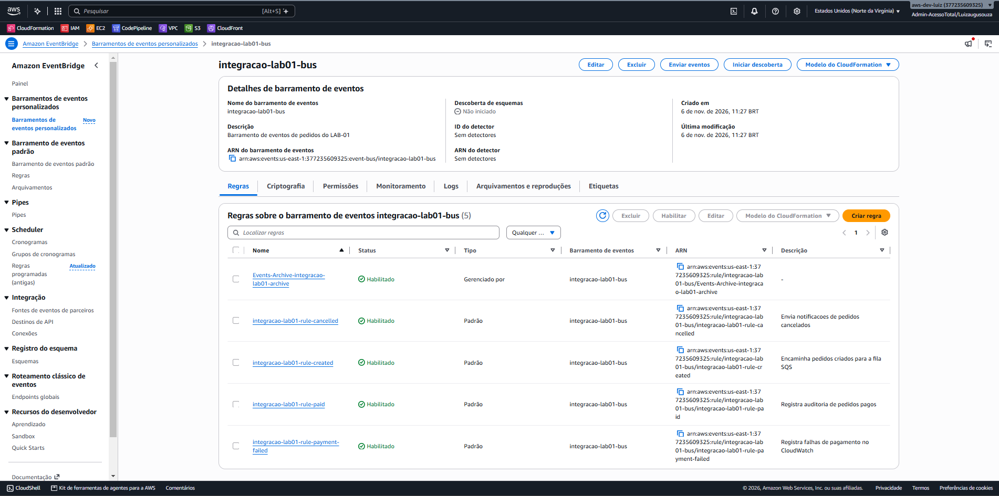
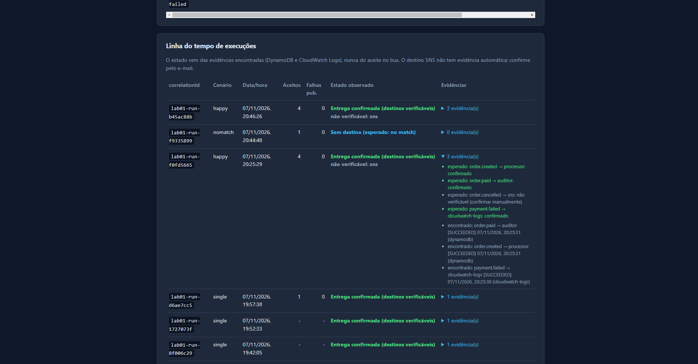
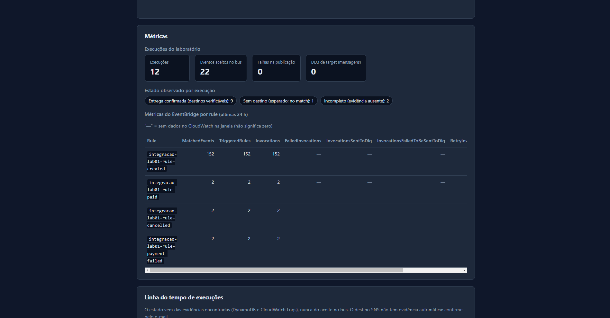
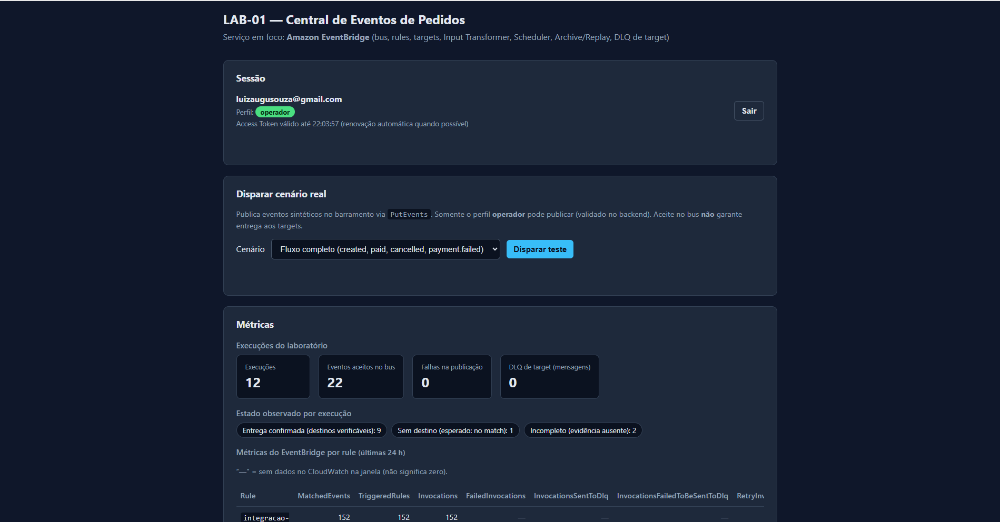

# Integração Serverless de Pedidos: Eventos, Regras e Destinos no EventBridge



*Leitura de cerca de 6 minutos · Amazon EventBridge, Lambda, SQS, SNS, DynamoDB, API Gateway e Cognito*

## Resumo

Este projeto mostra, na prática, como o **Amazon EventBridge** recebe eventos de pedidos e decide para onde cada um deve ir. Um sistema publica fatos de negócio (pedido criado, pago, cancelado, pagamento com falha). O EventBridge avalia **regras**, encaminha cada evento ao **destino certo** e um dashboard protegido por login mostra o que realmente aconteceu, sem confundir "aceito" com "entregue".

Tudo foi montado manualmente pelo Console AWS, sem Terraform e sem frameworks no frontend.

## O problema

Em um sistema de pedidos, vários times precisam reagir ao mesmo acontecimento: a fila de processamento quer saber dos pedidos criados, a auditoria dos pagamentos, o time de atendimento dos cancelamentos e a observabilidade das falhas. Se o produtor chamar cada consumidor diretamente, ele passa a conhecer todos eles, e qualquer mudança vira uma alteração no código.

A proposta é **desacoplar**: o produtor publica um evento em um barramento e as regras decidem quem recebe.

## A solução



*Figura 1 — Arquitetura da solução, de ponta a ponta.*

O fluxo, em quatro passos:

1. O operador entra no dashboard e escolhe um cenário.
2. A Lambda publicadora gera um `correlationId` e envia os eventos ao barramento.
3. As regras comparam cada evento com seu padrão e entregam ao destino correspondente.
4. Os consumidores gravam uma **evidência** no DynamoDB (ou no CloudWatch Logs), e o dashboard lê essas evidências.

## Roteamento: o coração do projeto

| Evento | Destino | O que acontece |
|---|---|---|
| `order.created` | Fila SQS → Lambda | Processamento assíncrono e registro da evidência |
| `order.paid` | Lambda de auditoria | Auditoria do pagamento (só para valores maiores que zero) |
| `order.cancelled` | Tópico SNS | Notificação por e-mail |
| `payment.failed` | CloudWatch Logs | Mensagem legível, gerada por um **Input Transformer** |
| `order.unknown` | Nenhum | Cenário "sem regra": o evento é aceito e descartado |

Dois recursos completam o quadro: o **Scheduler**, que publica um evento a cada 10 minutos (disparo por tempo, e não por padrão de evento), e o **Archive**, que guarda os eventos por 7 dias para permitir um **Replay**.



*Figura 2 — Regras do barramento, incluindo a regra gerenciada pelo Archive.*

## Aceito não é entregue

O ponto central do projeto é a **observabilidade fiel**. Quando o `PutEvents` responde com sucesso, o barramento apenas **aceitou** o evento. Isso não prova que algum destino o processou.

Por isso o dashboard calcula o estado de cada execução a partir de evidências reais:

| Estado | Significado |
|---|---|
| Aguardando / Parcial | As evidências ainda estão chegando |
| Entrega confirmada | Todas as evidências verificáveis apareceram |
| Incompleto / Sem evidência | O prazo passou e faltam evidências |
| Sem destino | Esperado no cenário "sem regra" |
| Falha | Erro na publicação ou no destino |

O envio por e-mail (SNS) não gera evidência automática, então o painel o marca como **não verificável** e pede conferência manual. Nenhum número é inventado: quando o CloudWatch não tem dados, a métrica aparece como "—" e não como zero.



*Figura 3 — Linha do tempo com execuções, estados observados e evidências.*



*Figura 4 — Métricas das execuções e do EventBridge por regra.*

## Login e permissões

O dashboard usa **OAuth 2.0 com Authorization Code e PKCE** no Amazon Cognito, adequado para uma página estática sem segredo de cliente. O token de acesso vai em cada chamada à API, e o API Gateway valida o JWT antes de qualquer código rodar.

Dois perfis controlam o que cada pessoa pode fazer:

| Perfil | Consultar | Publicar eventos |
|---|:-:|:-:|
| `operador` | Sim | Sim |
| `leitor` | Sim | Não (HTTP 403) |

A regra é aplicada **no backend**, a partir das claims do token. O botão desabilitado no navegador é só conveniência: o navegador nunca decide a permissão.



*Figura 5 — Dashboard autenticado com o perfil operador.*

## Resiliência

- **Retry e DLQ de entrega:** se o EventBridge não conseguir entregar a um destino, tenta novamente (2 vezes, por até 1 hora) e então envia o evento a uma fila de mensagens mortas.
- **DLQ de processamento:** se a Lambda falhar ao processar uma mensagem da fila, o SQS a move para outra DLQ depois de 3 tentativas. São duas filas diferentes porque são dois tipos de falha diferentes.
- **Idempotência:** os consumidores gravam com condição no DynamoDB. Um Replay ou uma reentrega não cria registros duplicados.

## O que este projeto ensina

- A diferença entre **evento aceito** e **evento processado**.
- Como padrões de evento filtram por origem, tipo e campos do conteúdo.
- Por que **agenda** (Scheduler) e **regra** (padrão de evento) são mecanismos diferentes.
- Quando usar **Input Transformer** e como comparar o payload original com o entregue.
- Por que Replay exige consumidores **idempotentes**.
- A diferença entre **falha de entrega** e **falha de processamento**.
- Como proteger uma SPA com Cognito sem expor segredos.

## Limitações

- O e-mail do SNS depende de conferência manual.
- A listagem usa `Scan` no DynamoDB, adequado ao volume pequeno do projeto.
- Os tokens ficam no `sessionStorage`; a proteção contra XSS vem de CSP restritiva e de um DOM montado sem `innerHTML`, o que reduz o risco mas não o elimina.
- Os dados são sintéticos e não há PII.

## Documentação

| Documento | Conteúdo |
|---|---|
| [IMPLANTACAO.md](IMPLANTACAO.md) | Passo a passo completo pelo Console AWS, validação final, custos e limpeza |
| [TESTE.md](TESTE.md) | Roteiro de testes feito pelo próprio dashboard |
| [ARQUITETURA.md](ARQUITETURA.md) | Componentes, fluxo de dados, estados e segurança |

## Estrutura do repositório

```text
src/          funções Lambda (publicação, processamento, auditoria e leitura)
frontend/     dashboard estático em HTML, CSS e JavaScript
eventbridge/  padrões das regras, Scheduler, Archive, retry e Input Transformer
iam/          políticas de identidade, políticas de recurso e relações de confiança
events/       eventos sintéticos de exemplo
imagens/      capturas de tela do Console AWS e do dashboard
```

Nenhum valor real de conta, endereço ou identificador está no repositório. Os documentos usam variáveis como `<ACCOUNT_ID>` e `<PREFIXO>`, descritas no início do [IMPLANTACAO.md](IMPLANTACAO.md).
