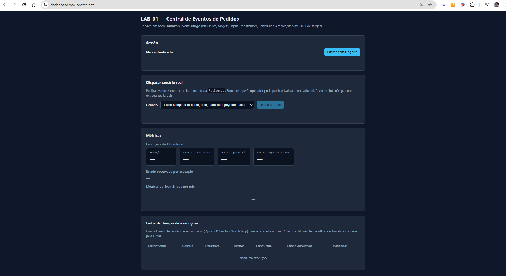
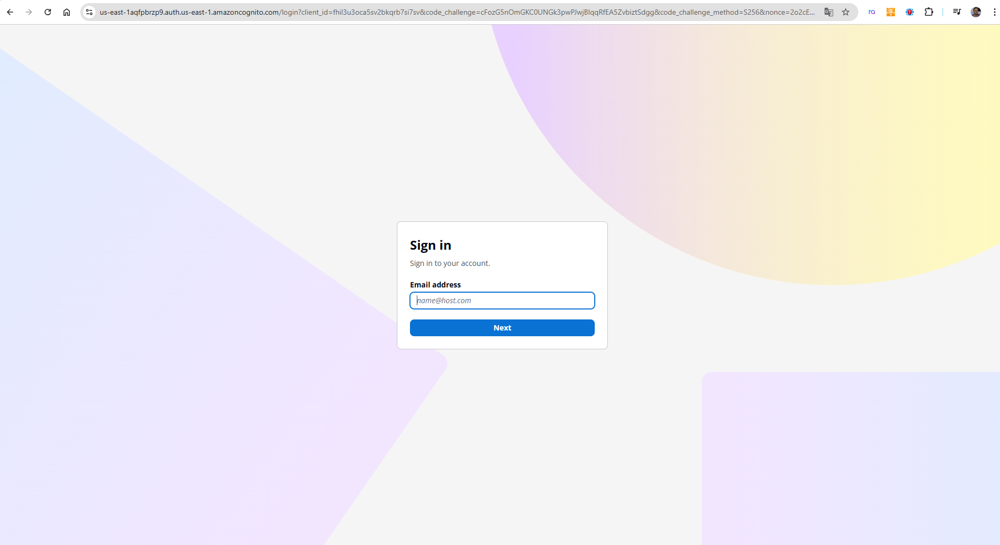
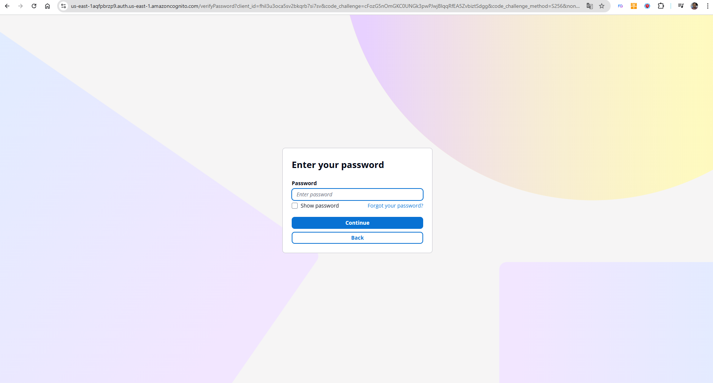
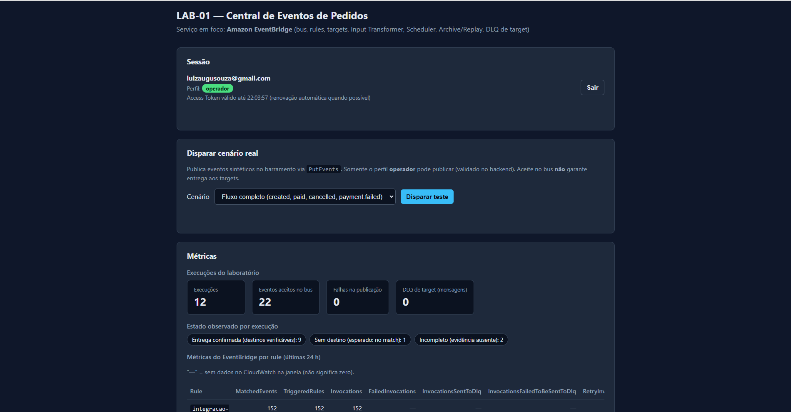
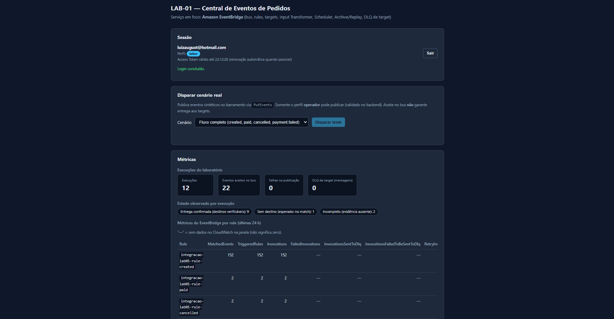
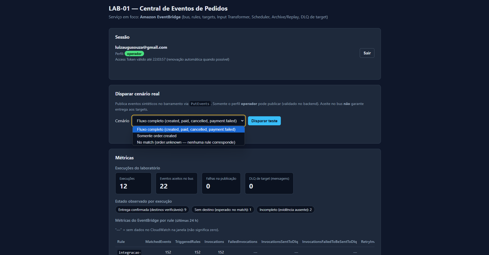
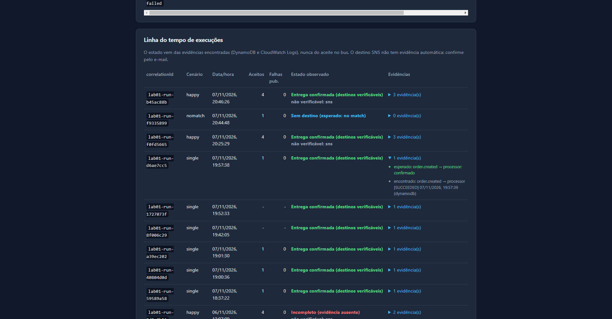
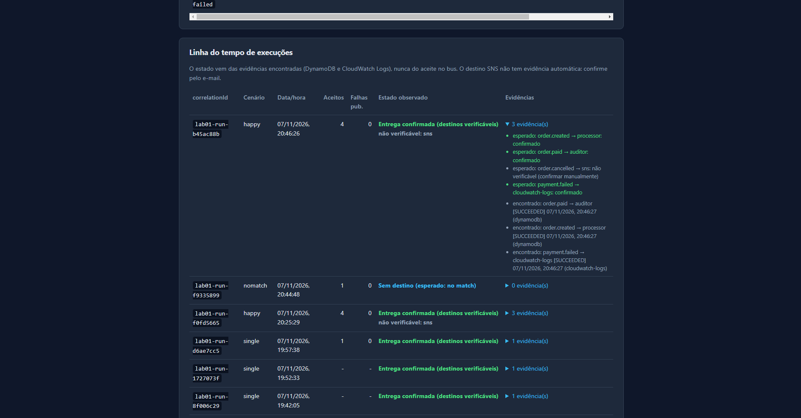
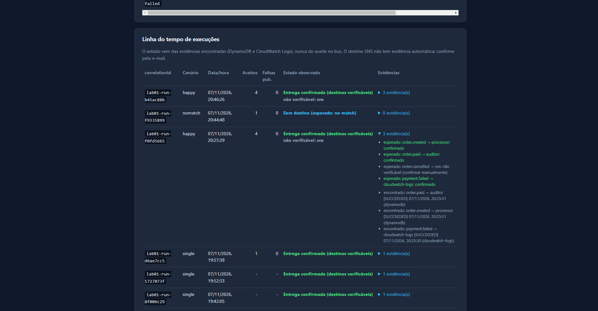
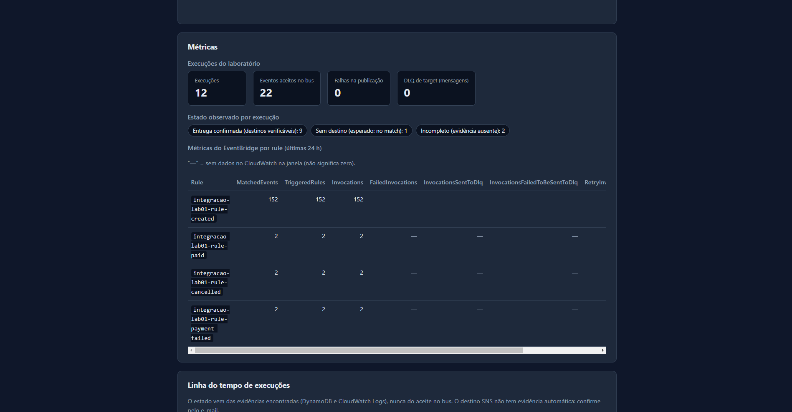

# Integração Serverless de Pedidos: Eventos, Regras e Destinos no EventBridge

**Documento:** Testes pelo dashboard

> Para implantar os recursos, veja [IMPLANTACAO.md](IMPLANTACAO.md). Visão geral em [README.md](README.md) e [ARQUITETURA.md](ARQUITETURA.md).

> **Objetivo:** testar, pelo próprio dashboard, como o Amazon EventBridge recebe eventos de pedidos, identifica regras e encaminha cada tipo de evento ao destino previsto. Este roteiro é para **usuários do painel**, não para implantar ou alterar recursos AWS.
>
> **Acesse:** <URL_DASHBOARD>
>
> Os pedidos, valores e identificadores gerados são **sintéticos**. Os testes usam recursos reais do projeto na AWS, mas não representam vendas reais.

## Antes de testar

1. Acesse o endereço do dashboard e clique em **Entrar com Cognito**, se necessário.
2. Confira na área **Sessão** se você está autenticado com o perfil **operador**. Esse perfil pode disparar cenários. O perfil **leitor** pode consultar, mas não publicar.
3. Na seção **Disparar cenário real**, escolha um cenário no campo **Cenário** e clique **uma única vez** em **Disparar teste**.
4. Leia o resultado abaixo do botão e anote o **correlationId** (exemplo de formato: `lab01-run-xxxxxxxx`). Esse identificador conecta a execução do dashboard às evidências da AWS.
5. Acompanhe a seção **Métricas** e a linha mais recente em **Linha do tempo de execuções**. Expanda **Evidências** para ver quais destinos foram observados. Se ainda estiver aguardando, espere a atualização automática do painel.

**Importante:** a mensagem “Aceite no bus” significa que o EventBridge aceitou a publicação, **não** que todos os destinos processaram a mensagem. Os contadores gerais e as métricas por regra podem incluir testes anteriores e eventos agendados. Compare principalmente a execução pelo seu `correlationId`.

**Evidências visuais**



*Figura 1 — Dashboard sem sessão, com o botão Entrar com Cognito.*



*Figura 2 — Login gerenciado do Cognito: etapa do e-mail.*



*Figura 3 — Login gerenciado do Cognito: etapa da senha.*



*Figura 4 — Dashboard com sessão do perfil operador.*



*Figura 5 — Dashboard com sessão do perfil leitor (publicação não permitida).*



*Figura 6 — Seletor de cenários do dashboard.*

## 1. Cenário “Somente order.created” (single)

**O que simula:** um sistema de vendas comunica que um pedido foi criado.

**No dashboard:** selecione **Somente order.created** e clique em **Disparar teste**.

**O que acontece na AWS:**

```text
Dashboard → API Gateway → Lambda publicadora
          → EventBridge (<PREFIXO>-bus)
          → regra <PREFIXO>-rule-created
          → SQS <PREFIXO>-proc-queue
          → Lambda <PREFIXO>-proc-fn
          → DynamoDB <PREFIXO>-runs
```

**O que observar no dashboard:**
- **Aceite no bus:** normalmente 1 evento aceito e 0 falhas de publicação.
- **Linha do tempo:** cenário `single`, com novo `correlationId`.
- **Evidências:** `order.created → processor` confirmado, com estado `SUCCEEDED`, quando o processamento realmente tiver terminado.
- **Estado observado:** **Entrega confirmada (destinos verificáveis)** quando a evidência esperada estiver presente.

**Onde esse teste pode ser encontrado na AWS:** regra **EventBridge** `<PREFIXO>-rule-created`; fila **SQS** `<PREFIXO>-proc-queue`; logs da **Lambda** `<PREFIXO>-proc-fn`; tabela **DynamoDB** `<PREFIXO>-runs` (item `PROCESS#order.created` do mesmo `runId`).

**O que você aprendeu:** o EventBridge roteia o pedido pela regra; a SQS mantém a mensagem até o consumo e a Lambda processadora registra uma evidência no banco. O EventBridge não grava diretamente o processamento no DynamoDB.

**Evidências visuais**



*Figura 7 — Linha do tempo com uma execução single e a evidência confirmada.*

## 2. Cenário “Fluxo completo (created, paid, cancelled, payment.failed)” (happy)

**O que simula:** quatro acontecimentos de pedidos enviados na mesma execução. **São quatro eventos JSON separados**, e não um JSON único dividido pelo EventBridge.

**No dashboard:** selecione **Fluxo completo (created, paid, cancelled, payment.failed)** e clique em **Disparar teste**.

**O que acontece na AWS:**

| Evento | Regra do EventBridge | Destino | O que significa |
|---|---|---|---|
| `order.created` | `<PREFIXO>-rule-created` | **SQS → Lambda processadora → DynamoDB** | Pedido criado e processado |
| `order.paid` | `<PREFIXO>-rule-paid` | **Lambda de auditoria → DynamoDB** | Pagamento registrado para auditoria |
| `order.cancelled` | `<PREFIXO>-rule-cancelled` | **SNS → e-mail do assinante** | Aviso de cancelamento |
| `payment.failed` | `<PREFIXO>-rule-payment-failed` | **CloudWatch Logs**, via Input Transformer | Falha de pagamento convertida em uma mensagem de log |

**O que observar no dashboard:**
- **Aceite no bus:** normalmente **4 eventos aceitos e 0 falhas de publicação**.
- **Linha do tempo:** cenário `happy` com um único `correlationId` que identifica a execução.
- **Evidências verificáveis:** `order.created → processor`, `order.paid → auditor` e `payment.failed → cloudwatch-logs`. Quando as três forem encontradas, o painel pode mostrar **3 evidências** e **Entrega confirmada (destinos verificáveis)**.
- **SNS:** `order.cancelled → sns` aparece como **não verificável automaticamente**. O dashboard **não consegue provar a chegada do e-mail**; essa parte depende da conferência na caixa de entrada e da assinatura confirmada. Por isso, “entrega confirmada (destinos verificáveis)” **não** significa que o e-mail também foi confirmado.

**Onde encontrar as evidências na AWS:**
- **Pedido criado:** regra EventBridge `rule-created`, SQS `<PREFIXO>-proc-queue`, Lambda `<PREFIXO>-proc-fn` e DynamoDB `PROCESS#order.created`.
- **Pedido pago:** regra EventBridge `rule-paid`, Lambda `<PREFIXO>-audit-fn` e DynamoDB `AUDIT#order.paid`. Nos logs da Lambda auditora é possível ver o JSON recebido por ela.
- **Pedido cancelado:** regra EventBridge `rule-cancelled`, tópico SNS `<PREFIXO>-notify-topic` e e-mail do assinante. Confira o `correlationId` no conteúdo da notificação.
- **Pagamento com falha:** regra EventBridge `rule-payment-failed` e grupo de logs CloudWatch `/aws/events/<PREFIXO>`. O **Input Transformer** extrai dados como pedido, valor e motivo e produz a mensagem legível.

**O que você aprendeu:** cada evento é avaliado pelas regras do mesmo barramento, podendo seguir para destinos e serviços diferentes, sem que o sistema publicador precise conhecer cada consumidor.

**Evidências visuais**



*Figura 8 — Linha do tempo com uma execução happy e as evidências expandidas.*

## 3. Cenário “No match (order.unknown — nenhuma rule corresponde)” (nomatch)

**O que simula:** uma aplicação publica um tipo de evento que não corresponde a nenhuma das quatro regras do projeto.

**No dashboard:** selecione **No match (order.unknown — nenhuma rule corresponde)** e clique em **Disparar teste**.

**O que acontece na AWS:**

```text
Dashboard → API Gateway → Lambda publicadora
          → EventBridge (<PREFIXO>-bus)
          → nenhuma regra corresponde a order.unknown
          → nenhum destino é acionado
```

**O que observar no dashboard:**
- **Aceite no bus:** normalmente **1 evento aceito e 0 falhas**.
- **Linha do tempo:** cenário `nomatch`, com novo `correlationId`.
- **Estado observado:** **Sem destino (esperado: no match)**.
- **Evidências:** **0 evidências**, o que é esperado neste cenário.

**Onde observar na AWS:** barramento EventBridge `<PREFIXO>-bus` e registro principal `RUN` da execução na tabela DynamoDB `<PREFIXO>-runs`. Não se espera registro `PROCESS#` ou `AUDIT#` desse evento.

**Atenção:** “sem destino” **não é falha de entrega** e **não envia a mensagem à DLQ**. A DLQ de target é usada quando existe um destino configurado e a tentativa de entrega falha. O Archive do barramento pode guardar o evento conforme seu filtro e sua retenção, mesmo sem regra de encaminhamento.

**Evidências visuais**



*Figura 9 — Linha do tempo com execuções happy e nomatch.*

## Como interpretar os números e os estados

| Item do dashboard | Interpretação |
|---|---|
| **Execuções** | Quantidade de execuções registradas; não é necessariamente igual ao número de eventos. |
| **Eventos aceitos no bus** | Total de eventos aceitos na publicação; não comprova consumo. |
| **Falhas na publicação** | Erros identificados durante o envio ao EventBridge. |
| **DLQ de target (mensagens)** | Mensagens na fila de falhas de **entrega a destinos**, se disponíveis. Zero é diferente de uma métrica sem dados. |
| **MatchedEvents / TriggeredRules / Invocations** | Métricas do EventBridge por regra, em uma janela de tempo; podem incluir outros testes e agendamentos. |
| **“—”** | Sem dados disponíveis naquela leitura/janela; **não significa zero**. |
| **Aguardando / Parcial** | A evidência ainda não apareceu ou só parte dos destinos verificáveis respondeu. |
| **Entrega confirmada (destinos verificáveis)** | As evidências verificáveis esperadas foram encontradas; destinos não verificáveis, como o e-mail SNS, ainda exigem conferência. |
| **Incompleto (evidência ausente)** | Falta evidência esperada após o prazo de observação. |
| **Sem destino (esperado: no match)** | O evento foi aceito sem encontrar regra correspondente; comportamento planejado. |

**Evidências visuais**



*Figura 10 — Métricas do projeto e do EventBridge por regra.*

## Registro simples do teste

Para cada execução, o usuário pode anotar:

| Campo | Preencher |
|---|---|
| Data/hora | |
| Cenário escolhido | |
| `correlationId` | |
| Eventos aceitos / falhas | |
| Estado observado | |
| Quantidade e tipos de evidências | |
| Se houve SNS, e-mail recebido? | |
| Resultado ou observação | |

## Dúvidas comuns

**Por que o evento aparece como aceito antes de aparecer como processado?**  
O `PutEvents` confirma a entrada no barramento. O processamento acontece depois, de forma assíncrona.

**O EventBridge guarda todos os eventos para consulta?**  
Não por padrão como uma lista de mensagens individuais. Este projeto dispõe de um Archive configurado, mas ele é destinado a retenção/replay e não substitui a visualização dos resultados no dashboard.

**Por que a SQS não mostra a mensagem depois do teste?**  
O consumidor Lambda pode ter recebido e removido a mensagem rapidamente após processá-la. A evidência persistente está no DynamoDB e nos logs da função.

**Por que não vejo o e-mail SNS confirmado no dashboard?**  
O painel não recebe automaticamente uma confirmação de entrega da assinatura por e-mail. Confirme o recebimento diretamente na caixa postal.

**O cenário No match é um erro?**  
Não. Ele demonstra que uma regra só encaminha eventos que correspondem ao seu padrão.

---

**Conclusão:** com estes três cenários, o usuário testa exclusivamente pelo dashboard o **encaminhamento por regras**, a **entrega observada em diferentes destinos** e o caso de **evento aceito sem regra correspondente**. A inspeção dos serviços AWS é complementar e não é necessária para disparar os testes.

> **Escopo:** este roteiro não executa testes destrutivos, não força falhas na DLQ, não inicia Replay e não altera a infraestrutura.
